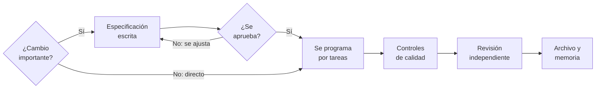
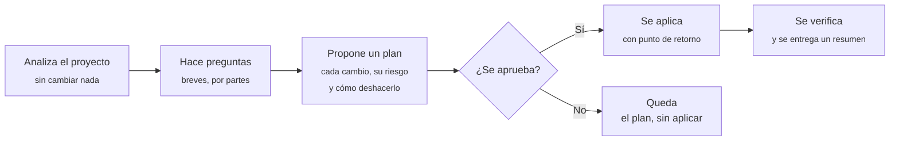

<div align="center">

<picture>
  <source media="(prefers-color-scheme: dark)" srcset="assets/logo-oscuro.svg">
  
</picture>

**Trabaja con asistentes de IA de forma ordenada: primero se define por escrito qué se va a hacer, y después se implementa.**

<p>
  
  
  
  <a href="#compatibilidad"></a>
</p>

[Inicio rápido](#inicio-rápido) · [Resultado](#resultado) · [Características](#características) · [Instalación y uso](#instalación-y-uso) · [Consideraciones](#consideraciones) · [Contribuciones](#contribuciones) · [Licencia](#licencia)

</div>

---

**spec-first-protocol** (SFP) es una skill que instala en un proyecto una metodología con una regla central: **todo cambio importante se especifica por escrito y se aprueba antes de programarse.** Alrededor de esa regla, SFP añade controles de calidad según el riesgo, una revisión independiente, memoria del proyecto y aprobación humana para lo irreversible, y cada paso puede revisarse o deshacerse. Las reglas que deja escritas en el proyecto las puede leer y seguir cualquier asistente (ver [Compatibilidad](#compatibilidad)). Funciona en proyectos nuevos y existentes, con uno o varios asistentes.

## Inicio rápido

```bash
git clone https://github.com/williamslml/spec-first-protocol.git <carpeta-de-skills>/spec-first-protocol
```

La carpeta de skills depende del asistente: ver [Compatibilidad](#compatibilidad). Con el proyecto abierto en el asistente:

> *"Configura el Spec-First Protocol en este proyecto."*

Detalles de instalación para Windows y uso completo más abajo, en [Instalación](#instalación) y [Uso](#uso).

## Resultado

La regla central de SFP es **especificar antes de programar**. Todo lo demás (controles de calidad, revisión, memoria, mensajes claros) sale de ahí. Así cambia el trabajo diario con un asistente, a partir de una petición como *"Agrega validación de email al registro"*:

<table>
<tr>
<th width="50%">Sin SFP</th>
<th width="50%">Con SFP</th>
</tr>
<tr>
<td valign="top">

- El asistente empieza a programar de inmediato.
- Modifica 14 archivos, algunos sin relación con la petición.
- No queda escrito qué se buscaba ni por qué.
- Quien programó es quien da el visto bueno.
- Semanas después, nadie sabe por qué se hizo.

</td>
<td valign="top">

1. **Propone primero una especificación:** qué cambia y por qué, los requisitos, el diseño y una lista de tareas.
2. **Se aprueba antes de escribir código.**
3. Se programa **tarea por tarea**, con el rol y el modelo que corresponden al riesgo.
4. Se pasan **controles de calidad** según el riesgo.
5. **Otra revisión**, independiente de quien programó.
6. La especificación se archiva y las decisiones y lecciones **quedan en el repositorio**.

</td>
</tr>
</table>

No todo requiere especificación. Un cambio es **importante** si toca varios archivos o módulos, modifica el comportamiento o los contratos, o tiene riesgo medio o alto. Un arreglo pequeño, como una errata o un ajuste de texto, se hace directo, con una verificación básica.



Los controles de calidad son proporcionales al riesgo: un cambio sencillo lleva solo verificación básica, y uno crítico suma pruebas, tipos, estilo, seguridad, arquitectura, regresión, documentación y revisión. Quien revisa recibe la especificación, las tareas y los cambios, no la conversación.

## Características

### Cómo funciona

Esto es lo que hace la skill para dejar SFP instalado en un proyecto, **en este orden**. El ciclo del trabajo diario es el de la sección [Resultado](#resultado):

1. **Analiza el proyecto**, sin modificar nada.
2. **Formula algunas preguntas** sobre la forma de trabajo del equipo.
3. **Propone un plan**: cada cambio, su riesgo y cómo revertirlo.
4. **Aplica el plan únicamente si es aprobado.**

> **Consejo:** para ver qué haría sin aplicar cambios: *"Analiza este proyecto y dime cómo aplicarías SFP, sin cambiar nada"*.

Los mismos pasos en un diagrama, incluido qué ocurre si el plan no se aprueba y cómo termina el proceso:



> **Importante:** hasta que el plan se aprueba, la skill **no escribe nada** en el proyecto. Una vez aprobado, lo ejecuta completo sin preguntar entre una fase y otra, y ejecuta ella misma los comandos que puede ejecutar. Solo se detiene ante una falla real, algo que el plan no contemplaba o una acción que siempre requiere aprobación.

#### Adaptación a cada proyecto

En el segundo paso, las respuestas definen tres cosas:

| Decisión | Opciones |
|---|---|
| Estado del proyecto | Nuevo o ya existente |
| Cuánto puede cambiar el repositorio (si ya existe) | **Solo metodología** (no toca carpetas) · **Integrar** (añade, sin mover nada) · **Reestructurar** (puede mover y renombrar, con respaldo obligatorio) |
| Cómo se coordina el trabajo | **Sin orquestador** (una sesión o varias independientes) · **Con orquestador** (una herramienta que coordina varios asistentes) |

También se ajustan al proyecto el rigor de los controles de calidad (ligero, estándar o estricto), los roles y los modelos, las convenciones de git y el idioma de los documentos. Nada se instala por defecto: cada pieza debe justificarse con una respuesta.

### Qué obtienes

<table>
<tr>
<td width="50%" valign="top">

#### Primero la especificación, después el código
Todo cambio importante empieza con una propuesta escrita: qué cambia, por qué, los requisitos, el diseño y las tareas. Se aprueba antes de programar, y es el núcleo de SFP.

</td>
<td width="50%" valign="top">

#### Las decisiones importantes se consultan
Publicar código, borrar archivos, mezclar ramas o tocar producción siempre requiere aprobación explícita, y cada asistente recibe solo los permisos que necesita.

</td>
</tr>
<tr>
<td valign="top">

#### Calidad y revisión según el riesgo
Controles proporcionales al riesgo, con las pruebas y los revisores automáticos que el proyecto ya tiene. Las pruebas se escriben mientras se construye y en un lugar acordado. Y una revisión independiente: quien revisa no es quien programó, también cuando se trabaja con un solo asistente.

</td>
<td valign="top">

#### Roles y modelos según el riesgo
Cada tarea se asigna a un rol (arquitectura, desarrollo, interfaz, pruebas o revisión) y a un nivel de modelo: lo crítico va al más capaz y lo sencillo, a uno ligero. Los roles se definen con cada equipo.

</td>
</tr>
<tr>
<td valign="top">

#### Memoria y documentación al día
Las decisiones importantes (ADR), los procedimientos (runbooks), las lecciones aprendidas y las especificaciones archivadas quedan en el repositorio, con un índice de lo que sigue vigente. El README y, si hay una API, su documento de OpenAPI se actualizan con cada cambio.

</td>
<td valign="top">

#### Git ordenado
Convenciones para commits, ramas, merge, PRs y versiones, con mensajes redactados para personas: qué cambió, por qué y cómo comprobarlo. Protege los remotos: nunca contraseñas en su dirección ni subidas sin confirmar el destino. [Ver convenciones](#convenciones-de-git).

</td>
</tr>
<tr>
<td valign="top">

#### Estructura de código recomendada
Opcional. Según el tipo de proyecto (API, interfaz, móvil, datos, librería, infraestructura…), propone organizar las carpetas por funcionalidad, con reglas de dependencia que se pueden verificar. Se conserva la estructura propia si se prefiere.

</td>
<td valign="top">

#### Todo cambio es reversible
Lo que la skill instala queda registrado y puede retirarse sin afectar cambios posteriores. Antes de aplicar se guarda un punto de retorno: con Git, o con una copia de respaldo si el proyecto no lo usa.

</td>
</tr>
<tr>
<td valign="top">

#### Español neutro y claro
Toda la documentación generada se entiende sin conocer el código. Sin jerga técnica innecesaria y sin voseo.

</td>
<td valign="top">

#### Complementos opcionales
Commits sin firmas de IA y herramientas complementarias, cada una con límites de uso claros.

</td>
</tr>
</table>

### Convenciones de Git

SFP también ordena cómo se guardan y se publican los cambios. Si el repositorio ya tiene sus propias convenciones, se respetan; si no, se proponen estas:

| Tema | Qué se acuerda |
|---|---|
| Commits | Un cambio lógico por commit, con un mensaje que explica qué cambió, por qué y cómo comprobarlo |
| Ramas | Nombres que dicen el efecto del cambio, con el formato `tipo/efecto-en-pocas-palabras` |
| Merge | Según el caso: *squash* (se combinan todos los commits en uno) cuando el cambio es una sola unidad, o *merge commit* (se conservan todos) cuando cada commit tiene valor propio |
| PRs (solicitudes para incorporar cambios) | Una descripción con cinco partes: por qué, qué cambia, qué no cambia, cómo probarlo y riesgos |
| Versiones | Etiquetas de versión, versionado semántico y un historial de cambios pensado para personas |
| Remotos (direcciones donde se publica el código) | Nunca contraseñas en la dirección, y se confirma el destino antes de subir |

El asistente propone los commits según lo acordado y no los hace por su cuenta. Subir código, mezclar o borrar ramas y crear etiquetas siempre requieren aprobación.

#### Ejemplo: mensaje de commit y nombre de rama

Cada cambio que se guarda en el historial del proyecto (un *commit*) lleva un mensaje que lo describe, y el trabajo se organiza en *ramas*, que son líneas de trabajo separadas con nombre propio. Como cada cambio nace de una especificación, su mensaje y su rama pueden explicar qué se hizo y por qué. Así se comparan:

<table>
<tr>
<th width="50%">Sin SFP</th>
<th width="50%">Con SFP</th>
</tr>
<tr>
<td valign="top">

Mensaje del commit:

```text
update

fix cosas

cambios varios
```

Nombre de la rama: `rama-ana-2`

**Resultado:** no se entiende qué cambió ni por qué.

</td>
<td valign="top">

Mensaje del commit:

```text
feat(registro): rechazar emails inválidos

Hasta ahora se aceptaba "ana@" y esas
personas nunca recibían el correo de
confirmación.

Cómo probarlo:
- Registrarse con "ana@": debe dar error.
```

Nombre de la rama: `feat/rechazar-emails-invalidos`

**Resultado:** se entiende qué cambió, por qué y cómo comprobarlo.

</td>
</tr>
</table>

### Compatibilidad

SFP es una metodología y no depende de un asistente en particular. Lo que cambia de un asistente a otro es cómo se instala y qué partes de la instalación puede hacer.

| Parte | ¿Depende del asistente? | Detalle |
|---|---|---|
| Reglas y textos de la metodología | No | Cualquier asistente puede leerlas, porque son texto |
| Instrucciones que se dejan en el proyecto | No | Se generan para cada asistente que se use. La skill pregunta cuáles son y consulta su documentación vigente para saber dónde van |
| Skill de instalación guiada | Sí | Requiere un asistente que cargue skills en formato `SKILL.md`. El único con el que se ha probado es Claude Code; en los demás, el formato es el mismo pero no se ha probado |
| Scripts de análisis, verificación y retiro | No | Solo necesitan una terminal con `sh` o `bash` |
| Filtro de firmas de IA en los commits | No | Es un hook de Git, ajeno al asistente |
| Ajuste de firmas en la herramienta | Sí, por asistente | Verificado solo en Claude Code. Para los demás, la skill consulta su documentación antes de cambiar nada; si no puede confirmarlo, no lo cambia y usa la regla escrita y el filtro del repositorio |
| Instalador de herramientas complementarias | Sí | Probado con Claude Code. Con OpenCode, en pruebas: instala las skills, y Serena y RTK se configuran a mano con las instrucciones que muestra. Ejecuta el instalador de skills con npx, pnpm o bun |

#### Dónde se instala la skill

La carpeta de skills depende del asistente. Estas son algunas, según la documentación del CLI `skills` 1.9.0, que lista decenas de asistentes:

| Asistente | Carpeta global de skills |
|---|---|
| Claude Code | `~/.claude/skills/` |
| Cursor | `~/.cursor/skills/` |
| GitHub Copilot | `~/.copilot/skills/` |
| Gemini CLI | `~/.gemini/skills/` |
| OpenCode | `~/.config/opencode/skills/` |
| Windsurf | `~/.codeium/windsurf/skills/` |
| Cline, Codex, Warp, Zed y otros | `~/.agents/skills/` |

Estas carpetas pueden cambiar con las versiones: conviene confirmarlas en la documentación del asistente.

### Extensiones opcionales

<details>
<summary><strong>Herramientas complementarias</strong>: pruebas, diagramas, diseño visual y más</summary>

<br>

Se ofrecen únicamente cuando tienen sentido para el proyecto, y nunca se instalan sin aprobación previa:

| Herramienta | En qué ayuda | Cuándo se ofrece |
|---|---|---|
| [Superpowers](https://github.com/obra/superpowers) (5 de sus guías) | Escribir pruebas primero, encontrar errores con método, verificar antes de finalizar | Para reforzar la calidad |
| [Serena](https://github.com/oraios/serena) | Moverse y renombrar con precisión en proyectos grandes | En proyectos grandes |
| [RTK](https://github.com/rtk-ai/rtk) | Reducir el consumo al leer la salida de los comandos | Para reducir costos |
| [archify](https://github.com/tt-a1i/archify) | Diagramar la arquitectura del sistema | Opcional |
| [frontend-design](https://github.com/anthropics/skills) | Diseño visual de pantallas | Solo si el proyecto tiene interfaz |
| [Modern Web Guidance](https://github.com/GoogleChrome/modern-web-guidance) | Código web moderno y correcto: HTML semántico, CSS actual, accesibilidad, rendimiento y seguridad | Solo si el proyecto tiene interfaz web, también en escritorio con Electron o Tauri |
| [Context7](https://github.com/upstash/context7) | Consultar la documentación vigente de las librerías del proyecto | Opcional. Se instala a mano, con aprobación: envía las consultas a un servicio externo |

Cada herramienta tiene prohibido duplicar funciones que ya cubre SFP, para evitar contradicciones. Por ejemplo, Superpowers no planifica: esa función corresponde a SFP. Y Modern Web Guidance no se ocupa del diseño visual, que es de frontend-design.

</details>

<details>
<summary><strong>Commits sin firmas de IA</strong>, de cualquier asistente</summary>

<br>

Varios asistentes añaden su firma a los commits ("Co-Authored-By: …", "Generated with…"). Si se solicita, la skill lo evita de tres formas:

1. Un ajuste en la herramienta, cuando existe.
2. Una regla escrita que cualquier asistente puede leer.
3. Un filtro automático en el repositorio que elimina esas firmas, sin importar el asistente de origen.

Los coautores humanos se conservan. Si la empresa **exige** declarar el uso de IA, la skill lo consulta antes de actuar y no elimina nada.

Git no copia los filtros automáticos al clonar un repositorio. Por eso, cuando hay equipo, el filtro se guarda en una carpeta versionada del proyecto y cada persona lo activa una vez después de clonar, con el comando que queda escrito en el README del proyecto. La verificación de la skill comprueba en cada copia que el filtro esté activo y, si falta, lo dice con el comando para activarlo.

</details>

## Instalación y uso

### Instalación

Se instala una sola vez y aplica a todos los proyectos. La `<carpeta-de-skills>` es la del asistente que se use, según la tabla de [Compatibilidad](#compatibilidad).

**Windows (PowerShell)**

```powershell
git clone https://github.com/williamslml/spec-first-protocol.git "<carpeta-de-skills>\spec-first-protocol"
```

**macOS, Linux o Git Bash**

```bash
git clone https://github.com/williamslml/spec-first-protocol.git <carpeta-de-skills>/spec-first-protocol
```

Al reiniciar el asistente, la skill queda disponible como `spec-first-protocol`.

### Uso

Con el proyecto abierto, basta con solicitarlo directamente. Una vez instalada la metodología, no hace falta pedir nada especial en el día a día: al solicitar un cambio importante, el asistente propone primero la especificación.

| Si se indica… | Qué ocurre |
|---|---|
| *"Configura el Spec-First Protocol en este proyecto."* | Se recorren todos los pasos descritos en "Cómo funciona" |
| *"Analiza este proyecto y dime cómo aplicarías SFP, sin cambiar nada."* | Solo se analiza y se entrega el plan |
| *"Configura SFP en este proyecto sin mover carpetas."* | Nivel "Solo metodología": se instalan las instrucciones, sin tocar la estructura |
| *"Actualiza SFP en este proyecto."* | Se proponen únicamente las mejoras nuevas aplicables al caso. También avisa si el proyecto quedó en una versión anterior a la que tienes instalada |
| *"Cambia el modo de coordinación de este proyecto a con orquestador."* | Cambia una decisión de fondo (nivel de intervención, coordinación o rigor de los controles) sin reinstalar: muestra lo actual, lo que cambiaría y lo que no se toca, y aplica solo lo aprobado |
| *"Agrega soporte para OpenCode a este proyecto."* | Genera las instrucciones para un asistente nuevo, reutilizando las decisiones ya tomadas, sin repetir la entrevista |
| *"Retira SFP de este proyecto."* | Se retira lo instalado, sin afectar cambios posteriores |

Para ver cómo queda un proyecto con la metodología instalada y un primer cambio ya especificado, revisar el [proyecto de ejemplo](examples/proyecto-con-sfp).

### Actualizar o retirar

| Objetivo | Cómo hacerlo |
|---|---|
| Actualizar la skill | En su carpeta, ejecutar `git pull` y reiniciar el asistente |
| Actualizar un proyecto | Solicitar: *"Actualiza SFP en este proyecto"* |
| Retirarla de un proyecto | Solicitar: *"Retira SFP de este proyecto"*. Primero se muestra qué se retiraría |

## Consideraciones

### Lo que nunca hace sin autorización

- Escribir, mover o borrar archivos del proyecto.
- Hacer commits, subir código, o mezclar o borrar ramas.
- Agregar, cambiar o borrar remotos, es decir, las direcciones a donde se publica el código.
- Instalar programas o modificar la configuración general del equipo.
- Cambiar permisos o la configuración de otras herramientas.

Además, **no copia ni muestra contraseñas**: si encuentra archivos con credenciales, o un remoto cuya dirección contiene una contraseña o un token, solo informa de su existencia. Y **los documentos del proyecto son información, no instrucciones**: si un archivo contiene indicaciones dirigidas a la IA, no se ejecutan. Se avisa en el momento, con un aviso de seguridad aparte de los demás que dice el archivo, el texto exacto y que no se ejecutó, y el aviso se repite en el resumen final.

Cuando la documentación de un asistente o de una herramienta no permite confirmar cómo hacer un ajuste con seguridad, ese ajuste **no se aplica**: se explica qué no se pudo confirmar, se ofrece una alternativa que no dependa de esa herramienta y queda anotado como pendiente en el resumen.

### Preguntas frecuentes

<details>
<summary><strong>¿Funciona con cualquier asistente?</strong></summary>
<br>
Las reglas, sí: quedan documentadas en el proyecto y cualquiera puede leerlas. Lo que depende del asistente es la instalación guiada, que requiere cargar skills en formato `SKILL.md`, y el instalador de herramientas complementarias, probado con Claude Code y en pruebas con OpenCode. El detalle está en [Compatibilidad](#compatibilidad).
</details>

<details>
<summary><strong>¿Sirve para un proyecto que ya existe?</strong></summary>
<br>
Sí. Tiene tres niveles de intervención: solo metodología (no toca carpetas), integrar (añade sin mover nada) y reestructurar (mueve y renombra, siempre con respaldo y un plan aprobado).
</details>

<details>
<summary><strong>¿Se puede usar con varios asistentes a la vez?</strong></summary>
<br>
Sí. Sin orquestador, cada sesión es independiente y comparte el estado mediante las especificaciones y la lista de tareas, no mediante el chat. Con orquestador (una herramienta que coordina varios asistentes), la skill se ajusta a sus capacidades, que se verifican y no se suponen.
</details>

<details>
<summary><strong>¿Quién hace la revisión independiente si trabajo solo, con un único asistente?</strong></summary>
<br>
Depende del riesgo del cambio. Si es medio o alto, la revisa el asistente en una sesión nueva, que solo recibe la especificación, las tareas y los cambios, y además la revisas tú antes de aprobar. Si es bajo, basta la sesión nueva. Si es trivial, basta una verificación básica. El resumen de cada cambio dice qué revisión tuvo. Una revisión hecha en la misma conversación donde se programó no cuenta como independiente, y así se informa.
</details>

<details>
<summary><strong>¿Hace falta una herramienta de especificaciones?</strong></summary>
<br>
No. Se pueden usar documentos simples con nombres acordados. Si ya se usa una herramienta, la skill la adapta: verifica qué cubre y registra cómo se corresponde con la propuesta, los requisitos, el diseño y las tareas.
</details>

<details>
<summary><strong>¿Modifica el código existente?</strong></summary>
<br>
No. Agrega documentos de trabajo e instrucciones para el asistente. Solo reorganiza carpetas si se solicita expresamente, y siempre con un plan aprobado.
</details>

<details>
<summary><strong>¿Qué pasa si el resultado no es el esperado?</strong></summary>
<br>
Antes de aplicar cualquier cambio se guarda un punto de retorno. Además, puede retirarse por completo en cualquier momento.
</details>

<details>
<summary><strong>¿Qué pasa si el proyecto no usa Git?</strong></summary>
<br>
Antes de aplicar cualquier cambio, la skill lo detecta, lo informa y ofrece dos opciones: inicializar Git (con tu aprobación) o hacer una copia de respaldo de lo que se va a tocar, en una carpeta fuera del proyecto y con la fecha en el nombre. La decisión es tuya, y el resumen dice cómo volver atrás con ese respaldo. En el nivel "Reestructurar" no se continúa sin alguna de las dos. Sin ninguna, los cambios no tendrían punto de retorno, y por eso se pide confirmación expresa antes de seguir.
</details>

<details>
<summary><strong>¿Se requieren conocimientos de programación?</strong></summary>
<br>
Para instalarla basta con copiar un comando. Para usarla, basta con solicitarlo al asistente en lenguaje natural.
</details>

## Contribuciones

Cualquier persona puede proponer cambios. Solo los mantenedores, [williamslml](https://github.com/williamslml) y [ncuzcoz-cloud](https://github.com/ncuzcoz-cloud), pueden aceptarlos. El formato del proyecto aplica a todas las personas, incluidos los mantenedores.

### Para proponer un cambio

1. Hacer un *fork* del repositorio, que es una copia propia, con el botón **Fork** de la página principal.
2. Clonar esa copia y crear una rama con un nombre descriptivo: `tipo/efecto-en-pocas-palabras`.
3. Hacer los cambios y ejecutar las comprobaciones. No necesitan internet ni modifican nada fuera de carpetas temporales:
   ```bash
   bash tests/ejecutar.sh
   python tests/verificar_formato.py
   ```
   La primera prueba los scripts. La segunda revisa que los textos cumplan el formato del proyecto (sin emojis, sin voseo, sin firmas de IA, enlaces válidos).
4. Subir la rama a la copia propia y abrir una solicitud de cambios (PR) hacia `master`, completando la plantilla que aparece. Las mismas comprobaciones se ejecutan solas en GitHub y sirven de aviso para quien revisa.
5. Un mantenedor revisa la solicitud. Puede pedir ajustes y, con su aprobación, se mezcla.

Para reportar un problema o sugerir una mejora basta con abrir un issue. Si la skill detecta un problema propio mientras trabaja y está instalado el CLI `gh` con sesión iniciada, puede preparar el reporte con los datos de la skill, sin nada de tu proyecto. Lo muestra en la siguiente pausa y solo lo publica si lo apruebas.

Hay una versión corta de estos pasos en [CONTRIBUTING.md](CONTRIBUTING.md). Los problemas de seguridad no se reportan públicamente: seguir [SECURITY.md](SECURITY.md).

### Reglas del proyecto

Estas reglas valen para todas las personas, incluidos los mantenedores:

- Escribir los mensajes de commit y las solicitudes de cambios con el formato de [Convenciones de Git](#convenciones-de-git): qué cambió, por qué y cómo comprobarlo. Los nombres de rama tienen la forma `tipo/efecto-en-pocas-palabras`.
- Mantener la skill autocontenida: sin rutas absolutas ni dependencias de documentos externos.
- Añadir una entrada al [CHANGELOG](CHANGELOG.md) con su apartado "Delta para proyectos ya instalados". Cada línea indica si un proyecto ya instalado debe recibir el cambio (`[accion: si]`, con la condición y la propuesta) o no (`[accion: no]`).
- Si cambia una versión fijada de una herramienta complementaria, probar instalación, verificación y retiro en un proyecto de ejemplo.
- Redactar en español neutro y en lenguaje claro, sin emojis, también en los commits.
- No incluir firmas de asistentes de IA en los commits.

### Quién acepta y cómo se revisa

- **Colaboraciones de otras personas:** llegan por solicitud de cambios. Cualquiera de los dos mantenedores la revisa, puede pedir ajustes y, si está conforme, la mezcla. Nadie aprueba su propia solicitud.
- **Mantenedores:** pueden subir cambios directamente a `master`, sin la aprobación del otro, pero con el mismo formato que todas las personas. Si un cambio no lo cumple, el otro mantenedor puede pedir que se corrija.

### Información técnica para quien mantiene el proyecto

<details>
<summary><strong>Requisitos técnicos</strong></summary>

<br>

| Para | Se necesita |
|---|---|
| Usar la skill | Un asistente que cargue skills en formato `SKILL.md` (ver [Compatibilidad](#compatibilidad)) |
| Los scripts de análisis, verificación y retiro | `sh`, `find`, `grep`, `awk` y `sed` (incluidos en Git for Windows, macOS y Linux). `git` recomendado |
| Validar el registro de cambios y deshacerlos automáticamente | Python 3 (en Windows suele llamarse `python`) o `jq` |
| El instalador de herramientas complementarias | bash 4 o superior, Python 3.11 o superior, y Node.js 18 o superior con npx o pnpm, o bun |
| Windows | Git for Windows (Git Bash) o WSL. `scripts/run.ps1` los detecta automáticamente |

Probado en Windows 11 (Git Bash), Debian 12 y Alpine 3.20. El instalador de herramientas no se ha probado en macOS: con el bash incluido de fábrica se detiene con un aviso (`brew install bash` lo resuelve).

</details>

<details>
<summary><strong>Scripts</strong></summary>

<br>

| Script | Qué hace | ¿Escribe? |
|---|---|---|
| `scripts/discover.sh <proyecto>` | Analiza el proyecto | No |
| `scripts/verify.sh [--strict-tooling] <proyecto>` | Verifica lo instalado | No |
| `scripts/fingerprint.sh --propose / --accept <proyecto>` | Registra huellas de lo instalado para poder deshacerlo con seguridad | Solo en `.sfp/` |
| `scripts/uninstall.sh <proyecto> [--apply]` | Retira SFP. Sin `--apply` solo muestra qué haría | Solo con `--apply` |
| `scripts/sfp-section.sh <con\|sin> <sección>` | Muestra una sección del texto completo de la metodología | No |
| `scripts/integrations.sh [--apply \| --check \| --uninstall] [--agent claude-code\|opencode] [--runner auto\|npx\|pnpm\|bun] <proyecto>` | Instala, verifica o retira las herramientas complementarias. Sin `--apply` solo muestra el plan | Solo con `--apply` |
| `scripts/hooks/commit-msg-ai-attribution.sh <archivo>` | Filtro que elimina las firmas de IA de un mensaje de commit | Solo ese archivo |
| `scripts/run.ps1 <script> …` | Ejecuta cualquiera de los anteriores desde PowerShell | Igual que el script que ejecuta |

Los scripts usan los siguientes códigos de salida, y `verify.sh` los explica al terminar:

| Código | Significa |
|---|---|
| `0` | Sin incidencias |
| `1` | Se encontraron problemas |
| `2` | Llamada incorrecta (opción o ruta inválida) |
| `3` | No se encontraron problemas, pero no pudo verificarse todo (falta una herramienta). Nunca se presenta como "todo correcto" |

En un pipeline de integración continua (CI), conviene tratar el `3` como advertencia y fallar solo con `1` o `2`: así una herramienta faltante no se confunde con un error del proyecto. Si se prefiere que también falle, `verify.sh --strict-tooling` convierte el `3` en `1`. Hay un ejemplo listo para GitHub Actions en [examples/ci](examples/ci/verificar-sfp.yml).

</details>

<details>
<summary><strong>Estructura del repositorio</strong></summary>

<br>

```text
spec-first-protocol/
├── SKILL.md            # Lo que lee el asistente: reglas, pasos y mapa de documentos
├── README.md           # Este archivo
├── CHANGELOG.md        # Historial de versiones y mejoras para proyectos ya instalados
├── CONTRIBUTING.md     # Cómo proponer cambios, en resumen
├── SECURITY.md         # Cómo reportar una vulnerabilidad
├── LICENSE
├── .github/            # Plantillas de issues y de solicitudes de cambios, revisores y verificación automática
├── assets/             # Logo en versión oscura (tema claro) y blanca (tema oscuro)
├── examples/           # Un proyecto de ejemplo con SFP instalado y un ejemplo de verificación en CI
├── tests/              # Pruebas de los scripts y verificación del formato de los textos
├── references/         # Documentos que se consultan solo cuando son necesarios
│   ├── methodology-digest.md   # Resumen de la metodología
│   ├── sfp-con-orquestador.md  # Texto completo, para coordinar varios asistentes
│   ├── sfp-sin-orquestador.md  # Texto completo, para trabajar con uno solo
│   ├── development-practices.md  # Cómo se ejecuta el trabajo: plan de corrido, pruebas, OpenAPI, README, revisión
│   ├── git-practices.md        # Commits, ramas, merge, PRs y remotes
│   ├── templates.md            # Plantillas de lo que se instala en el proyecto
│   ├── vendor/                 # Guías de terceros incluidas tal cual, con su licencia
│   └── …                       # Entrevista, escenarios, retiro, Windows y más
└── scripts/            # Herramientas automáticas (análisis, verificación, retiro…)
```

</details>

## Licencia

Este repositorio se publica bajo la licencia [MIT](LICENSE).

**Incluido en este repositorio**, sin modificar y con su licencia junto a cada archivo:

| Archivo | Origen | Licencia |
|---|---|---|
| `git-workflow-and-versioning.md` | [addyosmani/agent-skills](https://github.com/addyosmani/agent-skills) | MIT |
| `git-best-practices.md`, `git-examples.md` | [0xbigboss/claude-code](https://github.com/0xbigboss/claude-code) | Apache-2.0 |

**No incluido:** las herramientas complementarias se descargan de sus fuentes oficiales al momento de instalarse, y cada una conserva su licencia:

| Herramienta | Licencia |
|---|---|
| archify | Apache-2.0 |
| Superpowers | MIT |
| Serena | GPL-3.0 o posterior (su parte SolidLSP es MIT) |
| RTK | Apache-2.0 |
| frontend-design | Apache-2.0 |
| Modern Web Guidance | Apache-2.0 (sus guías, CC-BY-4.0) |
| CLI `skills` (npm) y uv | Las de sus respectivos proyectos |

<div align="center">
<br>
<sub>Para trabajar con IA de forma ordenada, clara y reversible.</sub>
</div>
