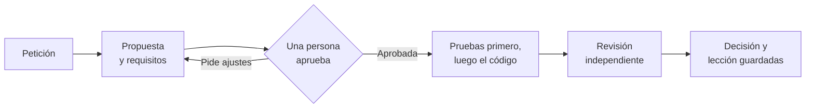

# Ejemplo: una tienda en línea con SFP instalado

Esta carpeta es un proyecto pequeño, con código y pruebas que funcionan, para ver cómo se trabaja con Spec-First Protocol día a día. La tienda es ficticia; los archivos y el flujo son los reales.

```bash
cd examples/proyecto-con-sfp
npm test        # 5 pruebas, todas correctas (requiere Node.js 18 o superior)
```

## Cómo fue el primer cambio

Alguien pidió: *"Que el registro rechace los correos mal escritos."* Esto fue lo que ocurrió:



Y así se vio la conversación:

> **Persona:** Que el registro rechace los correos mal escritos.
>
> **Asistente:** Es un cambio no trivial, así que primero te dejo la especificación en `specs/cambios/validar-correo/`. Antes de programar necesito tu aprobación. Una pregunta: ¿validamos en el navegador, en el servidor o en ambos?
>
> **Persona:** En el servidor manda; el navegador solo avisa.
>
> **Asistente:** Anotado como decisión 0001. Aprobada la propuesta, escribo primero las pruebas y después el código.
>
> **Asistente (más tarde):** Terminado. Una revisión independiente encontró que se rechazaba `ana+pedidos@ejemplo.com`. Ya está corregido, con su prueba, y quedó como lección para no repetirlo.

## Qué hay en cada lugar

| Archivo | Para qué sirve |
| --- | --- |
| [INSTRUCCIONES.md](INSTRUCCIONES.md) | Lo primero que lee el asistente: flujo, dónde vive cada cosa, qué requiere aprobación, cómo se ejecuta un plan aprobado, dónde van las pruebas y cómo se revisa |
| [specs/cambios/validar-correo/](specs/cambios/validar-correo/) | Un cambio terminado: propuesta, requisitos, diseño, tareas y revisión independiente |
| [specs/cambios/exportar-pedidos/](specs/cambios/exportar-pedidos/propuesta.md) | Un cambio **detenido a propósito**: el asistente hizo la propuesta y espera respuestas antes de programar |
| [docs/adr/](docs/adr/README.md) | Decisiones importantes, con un índice de las que siguen vigentes, para que nadie tenga que redescubrirlas |
| [docs/lecciones/](docs/lecciones/README.md) | Errores reales y cómo evitarlos la próxima vez, con su estado y un índice |
| [src/](src/registro.js) y [tests/](tests/registro.test.js) | El código y una prueba por cada requisito |
| [.sfp/manifest.json](.sfp/manifest.json) | Registro de lo que instaló la skill, con huellas, para poder retirarlo sin dañar el resto |

## Qué observar

- **La especificación va antes que el código.** Los requisitos tienen una prueba cada uno.
- **El asistente se detiene cuando corresponde.** El segundo cambio muestra una propuesta que no avanza sin aprobación.
- **Lo aprendido se guarda y se encuentra.** La lección del signo más ya no depende de la memoria de nadie, y los índices muestran qué sigue vigente.
- **Se sabe qué revisión tuvo cada cambio.** La revisión dice quién revisó y comprueba también dónde quedaron las pruebas.
- **No se inventan comandos.** Las instrucciones marcan como pendiente el formato, porque el proyecto aún no tiene ese comando.
- **Todo es reversible.** Desde la carpeta de la skill, `sh scripts/uninstall.sh examples/proyecto-con-sfp` muestra qué se retiraría, sin tocar nada.
