# Spec-First Protocol (SFP)

**Arquitectura y metodología**

- Propósito: un sistema personal para desarrollar software con ayuda de agentes de IA (programas que usan un modelo de IA para realizar tareas).
- Alcance: proyectos con varios agentes, varios modelos y varios proyectos a la vez.
- Nota: los modelos, entornos de ejecución y herramientas que se nombran aquí son **ejemplos**. Cada persona elige los que mejor se ajusten a sus necesidades y a su plan.

## Índice

1. [Propósito](#1-propósito)
2. [Principio central: separación de capas](#2-principio-central-separación-de-capas)
3. [Arquitectura general](#3-arquitectura-general)
4. [Responsabilidades por componente](#4-responsabilidades-por-componente)
5. [Modelo de autoridad](#5-modelo-de-autoridad)
6. [Orquestación](#6-orquestación)
7. [Especificación y planificación — capa de specs](#7-especificación-y-planificación--capa-de-specs)
8. [Runtime/CLI vs. Model vs. Agent](#8-runtimecli-vs-model-vs-agent)
9. [Agentes](#9-agentes)
10. [Modelos y routing](#10-modelos-y-routing)
11. [Ciclo de vida del desarrollo](#11-ciclo-de-vida-del-desarrollo)
12. [Quality gates](#12-quality-gates)
13. [Seguridad y human-in-the-loop](#13-seguridad-y-human-in-the-loop)
14. [Context engineering](#14-context-engineering)
15. [Jerarquía de contexto](#15-jerarquía-de-contexto)
16. [Memoria: chat, proyecto y metodología global](#16-memoria-chat-proyecto-y-metodología-global)
17. [Git y ADRs](#17-git-y-adrs)
18. [Conocimiento de proyecto vs. metodología global](#18-conocimiento-de-proyecto-vs-metodología-global)
19. [Gestión de cambios en la metodología](#19-gestión-de-cambios-en-la-metodología)
20. [Principios anti-crecimiento descontrolado](#20-principios-anti-crecimiento-descontrolado)
21. [Estructura del filesystem global](#21-estructura-del-filesystem-global)
22. [Skills](#22-skills)
23. [Observabilidad y métricas](#23-observabilidad-y-métricas)
24. [Principios fundamentales](#24-principios-fundamentales)
25. [Definición final del sistema](#25-definición-final-del-sistema)

---

## 1. Propósito

Spec-First Protocol (SFP) es una **arquitectura** para desarrollar software de forma sostenida, no una lista de instrucciones sueltas para modelos.

Qué hace el sistema:

- Coordina varios agentes y reparte tareas entre distintos modelos.
- Reutiliza conocimiento y conserva una memoria técnica.
- Controla la calidad y gestiona la seguridad.
- Documenta decisiones y mide resultados.
- Convierte la experiencia comprobada en una metodología reutilizable.

Requisito de independencia:

- El sistema no debe atarse a un modelo, proveedor, editor (IDE), runtime u orquestador concreto.
- Cualquiera de ellos debe poder cambiarse sin rediseñar la metodología.

---

## 2. Principio central: separación de capas

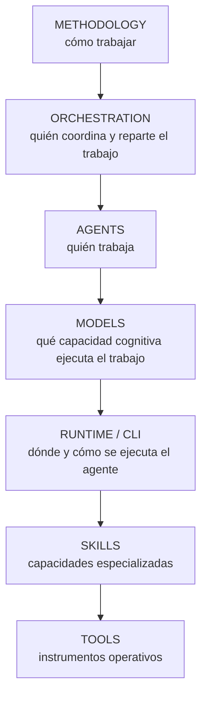

- Separar las capas evita que un proveedor, modelo o herramienta concreta se vuelva el centro de todo.
- **Independencia de proveedor:** la metodología no pertenece a ningún proveedor de modelos, runtime (entorno donde se ejecuta el agente), orquestador ni herramienta de especificación. Todos son reemplazables.
- **Nombres:** cada capa se nombra por su función, no por la herramienta de hoy. Si la herramienta cambia, solo cambia la elección anotada en el proyecto (manifiesto de `spec-first-protocol`), no la metodología.

---

## 3. Arquitectura general

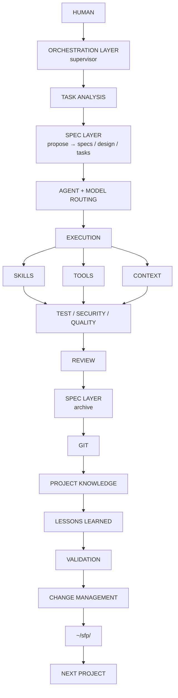

- Ciclo completo: de la persona hasta que lo aprendido pasa a la metodología global, que sirve al siguiente proyecto.
- En cambios no triviales, la capa de specs (escribe la especificación de cada cambio, sección 7) actúa dos veces: antes de ejecutar, produce el plan que reparte el "routing" (decidir qué agente y modelo hace cada tarea); al cerrar, archiva el cambio ("change") y actualiza las specs vigentes.
- El diagrama muestra ese camino. Un cambio trivial (sección 7) se salta SPEC LAYER: va de TASK ANALYSIS a AGENT + MODEL ROUTING, con verificación básica en vez de todos los controles de calidad ("quality gates", sección 12). No es un atajo fuera de la metodología: es la misma, con menos profundidad porque el riesgo lo permite.
- VALIDATION es la validación humana de una lección que podría generalizarse (sección 18.3), no las evaluaciones automáticas ("evals") de la sección 23. Los evals son una medición futura, aún fuera de este flujo, que podría aportar datos a esa validación además del juicio humano.

---

## 4. Responsabilidades por componente

| Componente | Responsabilidad |
|---|---|
| Human | Decisiones estratégicas y autoridad final |
| Orchestration Layer | Coordina a los agentes y reparte el trabajo |
| Capa de specs | Especifica y planifica cada funcionalidad o cambio |
| Agent | Rol y responsabilidad |
| Model | Capacidad de razonar y ejecutar |
| Runtime / CLI | Entorno de ejecución |
| Skill | Capacidad especializada |
| Tool | Herramienta concreta |
| Methodology | Estándares de trabajo |
| Git | Estado real del software |
| ADR | Decisiones de arquitectura permanentes |
| Docs | Conocimiento del proyecto |
| Runbooks | Procedimientos de operación |
| Metrics | Medición del sistema |
| Lessons Learned | Experiencias aún sin generalizar |
| `~/sfp/` | Metodología global reutilizable |

- Ninguna capa asume responsabilidades de otra.

---

## 5. Modelo de autoridad

No hay una sola jerarquía que mande en todo. Cada tema tiene su autoridad:

| Dominio | Autoridad |
|---|---|
| Alcance, objetivos, decisiones estratégicas o críticas, acciones irreversibles, cambios importantes de metodología | **Human** |
| Estado real del software | **Git / Filesystem** (los archivos en disco) |
| Decisiones y reglas propias del proyecto | **Project ADRs / Project Docs** |
| Metodología global | **`~/sfp/`** |
| Cómo se ejecuta técnicamente un agente | **Runtime / Agent configuration** |


- Un proyecto puede apartarse a propósito de una regla global por defecto si su contexto lo pide.
- Si ese desvío afecta a la arquitectura de forma relevante, se documenta en un ADR (registro de decisión de arquitectura, sección 17).
- Las restricciones críticas de seguridad siguen vigentes, salvo decisión humana explícita y controlada.

---

## 6. Orquestación

El orquestador coordina a los agentes. Su capa decide qué tareas hay y cómo dividirlas, qué agente y modelo usar, cuándo trabajar en paralelo, esperar o escalar (pasar a un modelo más capaz), y cuándo pedir intervención humana.

- No es la autoridad técnica máxima: la metodología fija los estándares, las decisiones concretas son del proyecto, y esta capa coordina dentro de esas reglas (sección 5).
- "Decide" no significa que el supervisor (agente que coordina) improvise: qué modelo usar y cuándo escalar sigue las señales de alto riesgo de la sección 10.3; cuándo pedir intervención humana, las acciones de alto impacto de la sección 13. Ambas son listas fijas, no criterio caso por caso.

**Implementación: a elección del usuario** (principio 4, sección 24). La capa se describe por su **función**, no por una herramienta. Qué ofrece un orquestador concreto se averigua antes de adoptarlo con el cuestionario de `orchestration.md` sección B.1; nunca se da por supuesto desde aquí.

- **Patrón supervisor-worker** (lo mínimo): un agente supervisor reparte tareas a agentes trabajadores ("workers"), cada uno en una sesión aislada del runtime que corresponda.
- **Formas típicas de coordinar:** delegación síncrona (entrega la tarea y espera), asíncrona (entrega y sigue) y mensajería directa (se comunica sin ceder el control). Cada orquestador ofrece solo algunas, con sus propios nombres.
- **Restricciones de herramientas ("tool restrictions"):** roles, listas de permitidos ("allowlists") y control de cumplimiento por agente o proveedor, si el orquestador los ofrece. Son la forma concreta de aplicar el *mínimo privilegio* (sección 13).
- **Memoria y autoaprendizaje ("self-learning"):** algunos orquestadores guardan lecciones solos; si existe, se trata según la sección 18.4.

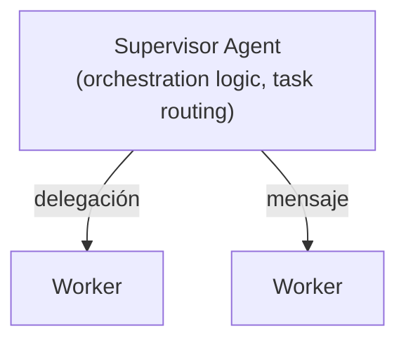

- **Límite que hay que comprobar:** el orquestador elegido define cuánto aísla a cada agente (proceso, contenedor, máquina virtual u otro). Si aísla menos de lo que exige el riesgo del proyecto (aislamiento de archivos o red), compénsalo con restricciones de herramientas explícitas por agente. Aislar procesos no basta para acciones de alto impacto (sección 13).

---

## 7. Especificación y planificación — capa de specs

Una spec (especificación) describe qué se va a construir antes de construirlo.

- Los cambios **no triviales** se escriben como documento planificado y versionado (con historial en Git) antes de que un agente escriba código. No quedan solo en el chat (sección 16).
- Un cambio es no trivial si toca varios archivos o módulos, cambia comportamiento o contratos (lo que otras partes esperan), o tiene riesgo medio o alto.
- Los triviales (por ejemplo, una corrección puntual o un ajuste de texto) pueden ir directo, con verificación básica (sección 12).

**Implementación:** a elección del usuario (o ninguna). SFP define esta capa por su **función**, no por una herramienta: un documento versionado por cambio, con propuesta, requisitos, diseño y tareas, que se archiva al terminar. Las capacidades y límites de la herramienta elegida se averiguan con el cuestionario de `tooling.md` sección 1 (skill `spec-first-protocol`). Lo que diga este texto sobre una herramienta concreta no sirve como fuente.

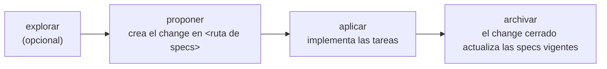

Cada cambio ("change") produce cuatro documentos, versionados en el propio repositorio del proyecto (los nombres los fija la herramienta; entre paréntesis, los habituales):

- Propuesta (`proposal.md`): por qué se hace el cambio y qué cambia.
- Requisitos (`specs/`): con escenarios comprobables (por ejemplo, `WHEN/THEN`: cuando pasa X, ocurre Y).
- Diseño (`design.md`): el enfoque técnico.
- Tareas (`tasks.md`): lista de pasos de implementación; es lo que la capa de orquestación (sección 6) reparte entre los workers.

- Requisito para la herramienta elegida: no atarse a un runtime (texto plano en el repositorio, usable desde cualquier asistente), en línea con la sección 2. Si no lo cumple, se anota como límite.

### 7.1 Frontera con ADR — evitar duplicación

La spec y el ADR (sección 17) no son lo mismo, y la diferencia se respeta para no romper el principio de contexto mínimo (sección 14):

| | **Spec (diseño / requisitos del change)** | **ADR (sección 17)** |
|---|---|---|
| Responde a | *Qué* se construye en esta funcionalidad | *Por qué* se tomó una decisión de arquitectura |
| Vigencia | Mientras el cambio está activo; se archiva al terminar | Permanente, no se archiva |
| Alcance | Una funcionalidad o cambio puntual | Decisión que afecta a muchas partes, difícil de revertir |

- **Regla:** el diseño de un cambio pasa a ADR solo si resulta ser una decisión de arquitectura que afecta a muchas partes, con el mismo criterio y flujo de aprobación que usa la sección 18 para llevar conocimiento a `~/sfp/`.
- Nunca se documenta la misma decisión dos veces en paralelo.

---

## 8. Runtime/CLI vs. Model vs. Agent

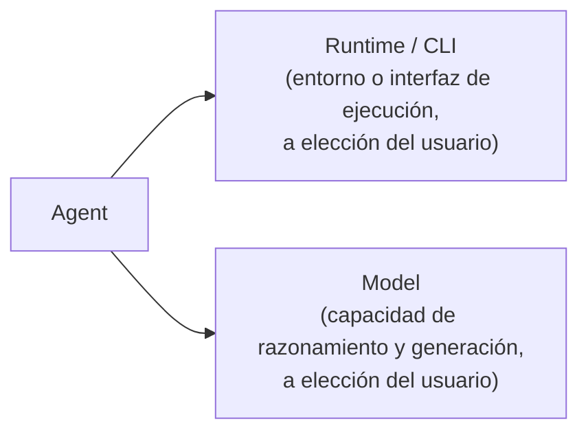

- **Runtime/CLI**: el programa o la terminal donde corre el agente.
- **Model**: aporta la capacidad de razonar y generar.
- La metodología no debe atarse a un runtime concreto.
- Un mismo nombre comercial puede designar un runtime o un modelo: el runtime es donde corre el agente; el modelo es quien razona.

---

## 9. Agentes

Los agentes representan roles (`Architect`, `Developer`, `Frontend`, `Tester`, `Reviewer`). Cada uno define:

- Responsabilidad, objetivos, qué recibe y qué entrega.
- Límites y criterios de calidad.
- Cuándo debe escalar (pasar el problema a otro nivel).

- Los agentes **no** deben copiar toda la metodología global, ni todas las herramientas y skills disponibles.
- Cómo se cargan estas plantillas en una sesión depende del runtime activo (sección 21.2); aquí se definen como fuente de verdad.

Plantillas iniciales:

```
~/sfp/agents/
├── architect.md
├── developer.md
├── frontend.md
├── tester.md
└── reviewer.md
```

---

## 10. Modelos y routing

### 10.1 Tiers de modelo (ejemplo)

- El routing se basa en **niveles de capacidad ("tiers")**, no en modelos concretos.
- Los modelos de la tabla son **ejemplos**: cada persona asigna a cada tier el que mejor se ajuste a sus necesidades, plan y presupuesto.

| Tier | Uso | Modelo (criterio) | % objetivo (ejemplo) |
|---|---|---|---|
| Alta capacidad | Riesgo o complejidad altos | El modelo más capaz disponible | 50% |
| Generalista | Trabajo normal y bien definido | Un modelo con buen equilibrio entre capacidad y coste | 30% |
| Ligero | Tareas simples y de bajo riesgo | El modelo más económico o rápido disponible | 20% |

- Los porcentajes son un reparto promedio de ejemplo, no cuotas fijas.
- El routing tiene en cuenta: complejidad, riesgo, ambigüedad, impacto, capacidad necesaria, coste, velocidad y rendimiento anterior.
- Los modelos de cada tier y el reparto cambian si la experiencia y las métricas muestran una configuración mejor.

### 10.2 Rol de cada tier

**Alta capacidad**: interviene donde el riesgo o la complejidad lo justifican, no en todo el trabajo.
- Arquitectura, planificación compleja, decisiones críticas, lógica de negocio difícil.
- Depuración compleja, reestructuraciones ("refactors") delicadas, seguridad, cambios entre sistemas.
- Integraciones complejas, revisión final, decisiones con pros y contras, ADRs.

**Generalista**: el worker principal.
- Implementación normal, APIs, CRUD (operaciones básicas de datos), pruebas, migraciones, scripts.
- Integraciones, documentación, exploración del repositorio, código base repetitivo.
- Actualizar dependencias, errores simples o medios, preparar PRs (solicitudes de cambio), refactors normales.

**Ligero**: worker completo, no limitado artificialmente a tareas triviales.
- Implementación, refactors, depuración, pruebas, APIs, exploración, documentación, mantenimiento.
- Funcionalidades de complejidad baja o media, tareas en paralelo, alternativas de implementación.
- Su lugar en el sistema depende de su rendimiento real.

### 10.3 Routing inicial

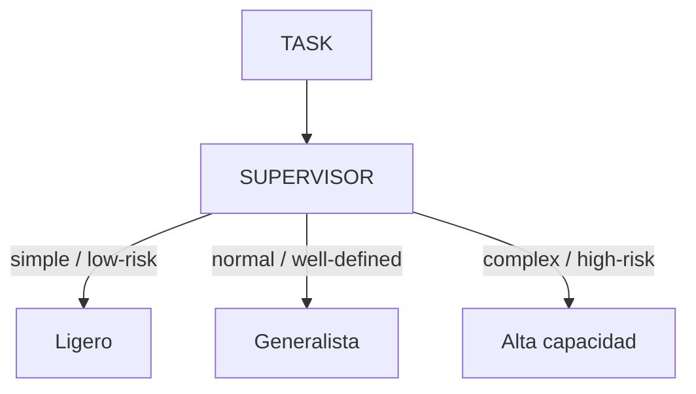

- Las señales de alto riesgo se fijan de antemano, no caso por caso (por ejemplo: la tarea toca producción, que es el sistema real en uso, autenticación, datos o contratos de API). Si se cumple alguna, la tarea va a Alta capacidad.
- Estas señales deciden qué **modelo** usar, no si hace falta **aprobación humana**: son distintas de las acciones de alto impacto de la sección 13, aunque algunas coincidan (como "producción"). Una tarea puede necesitar Alta capacidad sin aprobación humana, y al revés. Ambas listas son fijas, pero responden a preguntas distintas.

### 10.4 Escalamiento progresivo

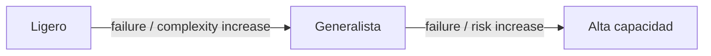

- Se escala a un tier superior solo con pruebas: errores, bloqueos, incertidumbre, riesgo, complejidad o resultados insuficientes.

### 10.5 Revisión crítica

En tareas críticas, quien implementa no es quien valida:


### 10.6 Ciclo de vida de una feature importante

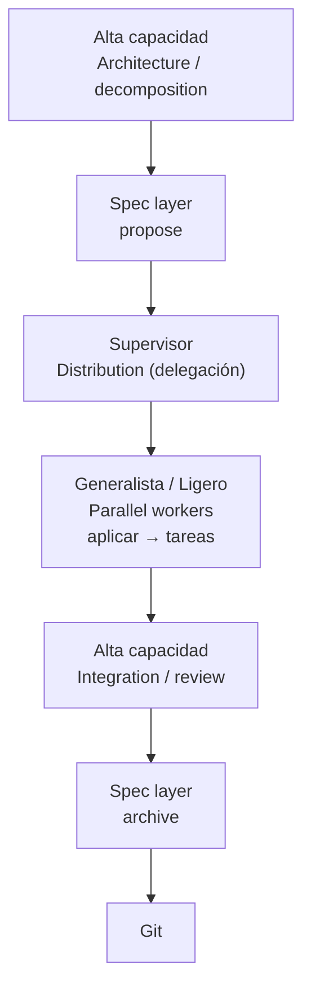

- Se trabaja en paralelo si ahorra tiempo sin subir sin necesidad el riesgo de integrar las partes.

---

## 11. Ciclo de vida del desarrollo

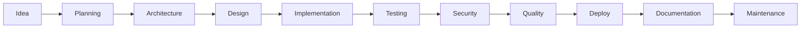

- La profundidad de cada fase depende del riesgo y la complejidad del proyecto.
- En **Planning/Architecture/Design** ocurre el ciclo propuesta → diseño → tareas de la capa de specs (sección 7).
- En **Implementation** actúa la capa de orquestación (sección 6).

---

## 12. Quality gates

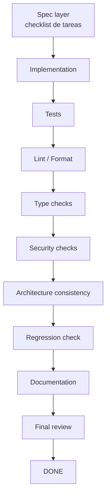

- Los quality gates son los controles de calidad que el trabajo pasa, en orden, antes de darse por terminado. No todas las tareas pasan todos: la profundidad depende del riesgo.
- **Cambio trivial** → implementation + verificación básica.
- **Cambio crítico** → tests + types + lint + security + architecture + regression + documentation + review.
- El sistema debe evitar la burocracia innecesaria.

---

## 13. Seguridad y human-in-the-loop

- "Human-in-the-loop": una persona interviene en las decisiones importantes. Principio: **mínimo privilegio** ("minimum privilege"), cada agente recibe solo los permisos necesarios.
- Las acciones de alto impacto (producción, operaciones destructivas, secretos como claves, pagos, infraestructura crítica, borrado masivo, cambios globales o de metodología) siguen este flujo. Esta lista no es la de señales de alto riesgo de la sección 10.3: aquella decide qué modelo usar; esta, si hace falta aprobación humana. Ambas son fijas y pueden coincidir en parte, pero no se intercambian.


- La intervención humana importa sobre todo en decisiones estratégicas, cambios de alcance, acciones irreversibles, seguridad crítica y cambios importantes de arquitectura o metodología.
- **Implementación:** si el orquestador elegido ofrece restricciones de herramientas (roles, listas de permitidos, control por proveedor; sección 6), son la forma de aplicar esto; su alcance real se comprueba con `orchestration.md` sección B.1.
- Recordatorio: un orquestador puede aislar procesos y no el sistema operativo. Lo que de verdad hace cumplir el mínimo privilegio son las restricciones de herramientas explícitas por agente.

---

## 14. Context engineering

- El contexto (lo que el agente tiene a la vista al trabajar) es limitado. Regla principal:

> **No cargar contexto que el agente no necesita.**

Se aplica con:

- El contexto mínimo suficiente.
- Revelación progresiva ("progressive disclosure"): lo esencial primero, el detalle solo si hace falta.
- Búsqueda en el momento justo ("just-in-time").
- Documentación permanente.
- Skills especializados.
- Memoria ordenada.

- La información se busca al necesitarla, no se carga por si acaso.

---

## 15. Jerarquía de contexto

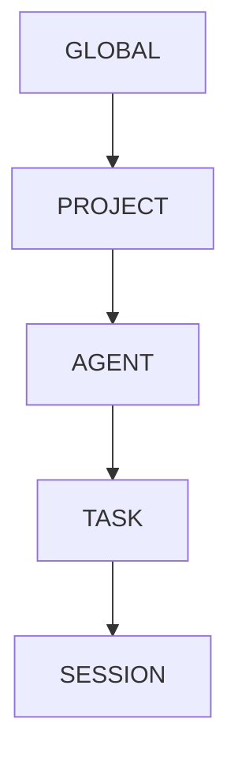

- Cada nivel aporta solo la información útil para su alcance.

---

## 16. Memoria: chat, proyecto y metodología global

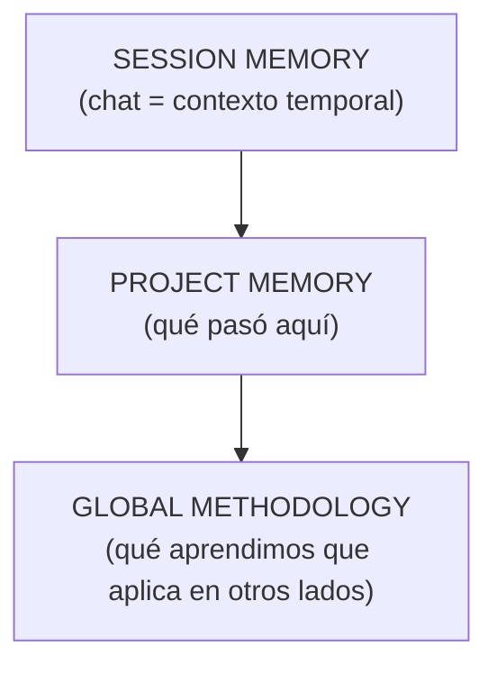

- El chat es contexto temporal, **no** la fuente permanente de conocimiento. Ese conocimiento vive en artefactos (documentos y registros):

| Artefacto | Contiene |
|---|---|
| Git | Estado real del software |
| ADR | Decisiones de arquitectura |
| Docs | Conocimiento del proyecto |
| Runbooks | Procedimientos de operación |
| `~/sfp/` | Metodología global |

- Separar memoria de proyecto y memoria global reduce ruido, contexto innecesario, mezcla entre proyectos, reglas falsas y sobrecarga mental.

---

## 17. Git y ADRs

- **Git** (control de versiones) es la fuente de verdad del estado real del software: código, configuración, historial, ramas, commits (cambios guardados), documentación versionada, cambios. La conversación no lo sustituye.
- **Los ADRs (Architecture Decision Records)** registran decisiones de arquitectura importantes: difíciles de revertir, que afectan a muchas partes o con pros y contras relevantes. No las triviales.

```
docs/
└── adr/
    ├── 0001-use-postgresql.md
    ├── 0002-authentication-strategy.md
    └── 0003-event-architecture.md
```

- Cada ADR incluye: **Status, Context, Decision, Alternatives, Consequences, References**, y guarda el razonamiento, no solo el resultado.
- **Los runbooks** describen procedimientos de operación repetibles: despliegue, vuelta atrás ("rollback"), recuperación, migraciones, resolución de problemas, respuesta a incidentes, mantenimiento. El razonamiento de arquitectura va en el ADR.

---

## 18. Conocimiento de proyecto vs. metodología global

- El conocimiento propio de un proyecto (arquitectura, decisiones, APIs, integraciones, convenciones, infraestructura, resolución de problemas) pertenece a ese proyecto y no pasa solo a otros.

### 18.1 De la experiencia a la lección aprendida

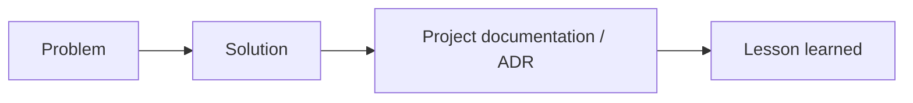

### 18.2 Promoción de conocimiento a metodología global

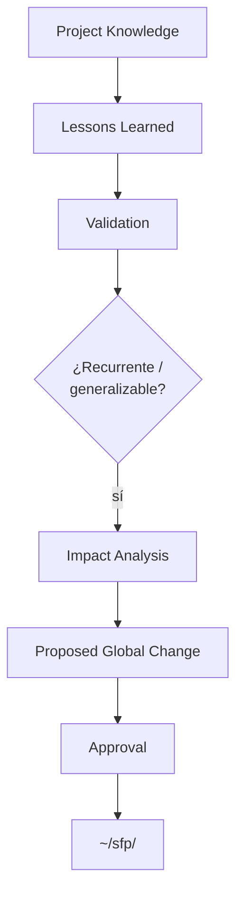

- Regla central: los proyectos generan conocimiento; `~/sfp/` guarda solo el generalizable y validado (sección 25).
- Un agente **no** cambia por su cuenta la metodología global solo porque aprendió algo: siempre sigue el flujo del diagrama.

### 18.3 Criterios para promover una experiencia a global

Una experiencia pasa a la metodología global cuando:

- Aparece repetidamente.
- Resuelve un problema general.
- Demuestra valor.
- Es aplicable a múltiples proyectos.
- Tiene un coste de adopción razonable.
- No introduce complejidad desproporcionada.
- Ha sido validada.

### 18.4 Implementación: self-learning del orquestador (si lo ofrece)

- El orquestador elegido puede automatizar el flujo de las secciones 18.1 a 18.2, con un umbral numérico en vez de solo juicio humano. **No todos lo ofrecen**; si no, se usa el registro manual (`sfp-sin-orquestador.md` sección 17.4).
- Suele ser **opcional ("opt-in")**: comprueba si viene activo por defecto y actívalo solo de forma explícita.
- **Dónde quedan las lecciones:** la memoria del orquestador puede estar en archivos propios fuera del repositorio (sin versionar en su Git). Ubicación y formato dependen de esa herramienta y se comprueban en su documentación vigente (`orchestration.md` sección B.1), no aquí.
- **Regla para encajarlo con las secciones 16 a 17 (no negociable, sea cual sea ese detalle):** la memoria del orquestador es memoria **de trabajo** de los agentes, no la fuente de verdad del proyecto; esa siguen siendo Git y `docs/` (secciones 16 a 17). Lo aprendido en un cambio que deba conservarse se registra en `docs/lessons/` (Git), igual que en el flujo manual. La memoria del orquestador nunca sustituye ese registro, solo lo alimenta.

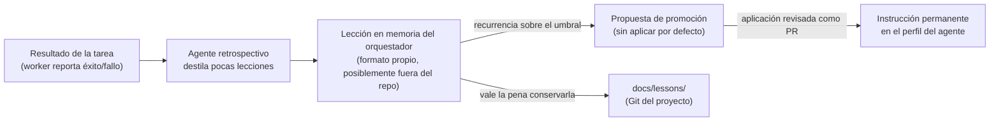

- Diferencia con el flujo de la sección 18.2: aquí la aprobación humana (sección 13) llega al aplicar la promoción.
- Cada promoción se revisa como una solicitud de cambio ("pull request") que modifica las instrucciones base ("system prompt") de un agente; nunca se aplica sin revisión.
- El umbral del orquestador suele contar las veces que se consultó la lección, no casos independientes. Para llevar algo a la metodología global se sigue usando el criterio de la sección 18.3.

---

## 19. Gestión de cambios en la metodología

- Cambiar `~/sfp/` exige un proceso formal, para que no se llene de reglas accidentales.
- Este proceso **continúa la cadena de la sección 18.2** (Project Knowledge → ... → Approval → `~/sfp/`); el paso extra es versionar formalmente el cambio:

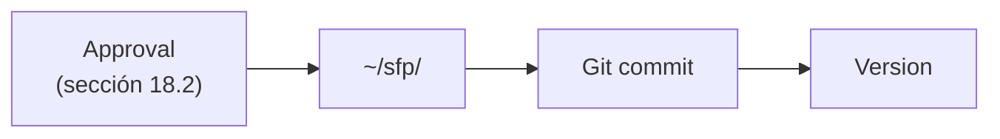

- `~/sfp/` debe guardarse en Git para saber qué cambió, por qué, cuándo, qué experiencia lo originó y qué impacto tuvo.

---

## 20. Principios anti-crecimiento descontrolado

- **No generalizar de más**: no convertir una experiencia aislada en regla global; añadir solo lo que demuestre valor.
- **No complicar de más ("overengineering")**: el sistema no debe exigir más mantenimiento que los proyectos que ayuda a construir. Cada archivo, skill, agente, herramienta, proceso o regla justifica su existencia.

> No añadir complejidad porque podemos; añadirla porque la experiencia demuestra que hace falta.

- `~/sfp/` es una **metodología viva**, no una documentación terminada.
- Empieza con plantillas, principios, estructuras base y reglas iniciales, y evoluciona así:

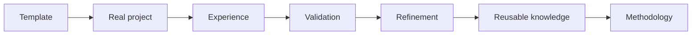

---

## 21. Estructura del filesystem global

- `~/sfp/` es solo el nombre de ejemplo de la **carpeta de metodología global**. El nombre real, su ubicación y si coincide con el de un proyecto los elige el usuario; la metodología no depende de ese nombre.

```
<carpeta de metodología global>/   (ejemplo: ~/sfp/)
│
├── SYSTEM.md
│
├── methodology/
│   ├── DEVELOPMENT.md
│   ├── ARCHITECTURE.md
│   ├── TESTING.md
│   ├── SECURITY.md
│   ├── DEVOPS.md
│   ├── QUALITY.md
│   └── DOCUMENTATION.md
│
├── skills/
│   └── <skill>/              # uno por capacidad validada (ver Skills)
│
├── tools/
│   └── <tool>/
│
└── agents/
    ├── architect.md
    ├── developer.md
    ├── frontend.md
    ├── tester.md
    └── reviewer.md
```

- La estructura puede cambiar según necesidades reales, sin volverse antes de tiempo una clasificación excesiva.
- La carpeta de la capa de specs (sección 7) está **dentro del repositorio de cada proyecto**, no en la carpeta global: es planificación del proyecto, no metodología global (el principio proyecto frente a global de la sección 18, aplicado a las specs).

### 21.1 Contenido de cada documento de metodología

| Archivo | Cubre |
|---|---|
| `SYSTEM.md` | Propósito, principios, arquitectura, responsabilidades, relación entre capas, reglas fundamentales. **No** contiene todas las reglas de operación. |
| `DEVELOPMENT.md` | Git, ramas, commits, modularidad, dependencias, nombres, convenciones, PRs, colaboración, mantenimiento |
| `ARCHITECTURE.md` | Principios de arquitectura, componentes, límites, acoplamiento y cohesión, interfaces, patrones, decisiones, pros y contras. No impone la misma arquitectura a todos los proyectos |
| `TESTING.md` | Pruebas unitarias, de integración, E2E y de contrato, mocks, fixtures, regresión, cobertura, casos límite (la estrategia concreta depende del proyecto) |
| `SECURITY.md` | Secretos, autenticación y autorización, validación, limpieza de datos, OWASP, dependencias, logs, mínimo privilegio, seguridad de APIs, errores seguros |
| `DEVOPS.md` | Docker, CI/CD, entornos, despliegue, migraciones, rollback, secretos, observabilidad, copias de seguridad, recuperación ante desastres |
| `QUALITY.md` | Corrección, mantenibilidad, legibilidad, seguridad de tipos, lint, formato, complejidad, manejo de errores, rendimiento básico, Definition of Done (cuándo algo está terminado) |
| `DOCUMENTATION.md` | README, documentación de APIs, ADRs, runbooks, changelog, documentación técnica y de despliegue |

- Al principio no se crean `PERFORMANCE.md` ni `FOLDER_STRUCTURE.md` aparte, salvo que la experiencia lo pida: el rendimiento queda en Quality, y la estructura de carpetas depende de lenguaje, framework, arquitectura, tamaño e infraestructura.

### 21.2 Ubicaciones y carga

- Ningún runtime lee solo la carpeta global: cada editor, terminal o agente usa su propia ubicación y formato para configurar proyecto, agentes y skills.
- Por eso `methodology/`, `skills/`, `tools/` y `agents/` no se cargan solos: son la **fuente de verdad**, independiente del runtime. Para que un runtime los use hace falta una capa de enlace (enlace simbólico, copia generada o archivo de configuración propio) que lleve el contenido adonde ese runtime lo espera.
- Esa capa de enlace es propia de cada runtime, se genera o regenera según cuál esté activo y no es parte de la metodología global: solo conecta la carpeta global con el runtime del usuario.
- Las plantillas `agents/*.md` tampoco se cargan solas: se usan cuando el runtime activo las referencia o las copia a su forma de definir agentes (subagentes, "system prompt", perfil de agente, etc.), que depende de cada runtime.
- Qué runtimes admiten este enlace y cómo se hace en cada uno es un detalle de implementación (sección 2), no una regla: debe poder generarse para cualquier runtime sin rediseñar la estructura global.

```
<proyecto>/
├── <ruta de specs>/      # la que fije la herramienta elegida
│   ├── <specs vigentes>/
│   └── <changes>/
│       ├── <en-curso>/
│       └── <archivados>/
└── docs/
    ├── adr/               # decisiones permanentes (sección 17)
    ├── runbooks/          # procedimientos operativos (sección 17)
    └── lessons/           # lecciones aprendidas del proyecto (sección 18.4)
```

---

## 22. Skills

- Un skill es una **capacidad especializada** (instrucciones y recursos para un tipo de tarea), distinta de una tool, que es una herramienta concreta.
- Un skill puede usar varias tools, y varios skills pueden usar la misma tool.
- Deben aplicar la revelación progresiva (sección 14):

```
skill/
├── SKILL.md
├── references/
├── examples/
└── scripts/
```

- `SKILL.md` es la entrada: lleva al agente a más información solo cuando la necesita.
- Esta estructura vive en la carpeta global como fuente de verdad; cómo llega al runtime activo lo resuelve la capa de enlace de la sección 21.2.

Los skills se describen por **función**, no por producto. Cuáles usar (o ninguno) lo decide el usuario; este texto no recomienda ninguno. Las capacidades y límites del skill o la tool elegidos se averiguan con `tooling.md` sección 2 (skill `spec-first-protocol`).

| Función | Qué cubre | Cuándo se justifica |
|---|---|---|
| Flujo de trabajo | Planificación, lluvia de ideas, TDD (primero las pruebas), depuración, revisión, verificación, subagentes | Complementa la metodología, no la sustituye |
| Navegación de código por significado | Entender, editar y reestructurar código por símbolos (funciones, clases), análisis eficiente de contexto | Repositorios grandes |
| Menos ruido en la terminal | Menos tokens (texto que procesa el modelo) por salida de comando, más información útil | Mejora práctica, no metodología |
| Visualización de arquitectura | Diagramas de componentes y dependencias | Complementa `ARCHITECTURE.md`, no lo sustituye |
| Diseño visual de interfaz (frontend) | Dirección visual, composición, accesibilidad, animación, coherencia | Solo con interfaz; no cargar en tareas de servidor (backend) |

### 22.1 Project Setup Skill

Skill de arranque para adoptar la metodología en proyectos nuevos o existentes. Es el skill `spec-first-protocol`, que contiene esta metodología completa:

```mermaid
flowchart LR
    NP[Nuevo proyecto] --> PSS[Project Setup Skill] --> Prep[Preparación del proyecto] --> Meta["Metodología disponible"] --> Ready[Proyecto listo]
```

- No debe convertirse en una copia completa de `~/sfp/`.
- Su función es conectar la metodología global con el contexto propio del nuevo proyecto.

---

## 23. Observabilidad y métricas

- Observabilidad: ver con datos cómo funciona el sistema. No basta con saber si el software funciona; también hay que saber si el **sistema de agentes** funciona bien.

Métricas iniciales:

- Tasa de éxito, de fallo y de retrabajo.
- Latencia y consumo de tokens o peticiones.
- Coste.
- Porcentaje de tareas escaladas.
- Correcciones durante la revisión.
- Tiempo hasta resolver.
- Rendimiento por modelo y por tipo de tarea.

- No hace falta montar ya una infraestructura compleja: primero se reúnen datos reales. Más adelante:

```
~/sfp/evals/
├── routing/
├── coding/
├── debugging/
├── testing/
└── architecture/
```

- Los modelos se evalúan por tipo de tarea (programar, depurar, arquitectura, pruebas, revisión), y el reparto puede cambiar según los resultados observados.

---

## 24. Principios fundamentales

1. Independiente del agente.
2. Independiente del modelo.
3. Independiente del runtime.
4. Independiente del orquestador y de la herramienta de especificación.
5. Tener en cuenta el proyecto.
6. Git como fuente de verdad del software.
7. ADRs como memoria de las decisiones de arquitectura; la capa de specs como memoria de ejecución de una funcionalidad (sección 7.1). Nunca ambos para lo mismo.
8. Docs como conocimiento del proyecto.
9. Chat como contexto temporal.
10. Revelación progresiva.
11. Contexto mínimo necesario.
12. Mínimo privilegio.
13. Control humano sobre decisiones críticas.
14. Evolución basada en evidencia.
15. No globalizar experiencias aisladas.
16. Añadir complejidad solo cuando esté justificada.
17. Medir el sistema.
18. Separar ejecución de validación.
19. Usar capacidades especializadas solo cuando sean relevantes.
20. Mantener ligera la metodología global.
21. Preferir conocimiento reutilizable validado sobre instrucciones duplicadas.
22. Preferir herramientas maduras que ya resuelven un problema sobre construir metodología adicional para lo mismo (sección 18.4).

---

## 25. Definición final del sistema

> **Spec-First Protocol (SFP)** es un sistema personal, independiente de proveedores, para desarrollar software con varios agentes y modelos coordinados por una capa de orquestación, planificado con especificaciones versionadas cuando el cambio lo merece. Usa una metodología global versionada, conocimiento propio de cada proyecto, memoria técnica permanente, documentación, ADRs, skills especializados, herramientas, quality gates, seguridad, observabilidad y aprendizaje continuo basado en la experiencia real.

Glosario de capas (arquitectura general en la sección 3):

| Capa | Significado | Implementación |
|---|---|---|
| Orchestration Layer | Coordina y reparte el trabajo | A elección del usuario; capacidades y límites con `orchestration.md` sección B.1 (sección 6) |
| Spec Layer | Planifica y especifica cada funcionalidad | A elección del usuario (o ninguna); capacidades y límites con `tooling.md` sección 1 (sección 7) |
| Methodology | Cómo funciona el sistema | `~/sfp/` |
| Agents | Quién trabaja | — |
| Models | Capacidad de razonar y ejecutar | A elección del usuario; criterios en la sección 10.1 |
| Runtimes | Entorno donde se ejecuta el agente | A elección del usuario |
| Skills | Capacidades especializadas | A elección del usuario; funciones en la sección 22, comprobación con `tooling.md` sección 2 |
| Tools | Herramientas concretas de trabajo | — |
| Git | Estado del software | — |
| ADRs | Decisiones de arquitectura (permanentes) | `docs/adr/` |
| Project Docs | Conocimiento del proyecto | — |
| Runbooks | Procedimientos de operación | `docs/runbooks/` |
| Metrics | Medición del sistema | — |
| Lessons Learned | Experiencia pendiente de validar | Memoria del orquestador (si la ofrece) + `docs/lessons/` (sección 18.4) |
| `~/sfp/` | Metodología global validada | — |
| Project-Setup Skill | Mecanismo de arranque de proyectos | Skill `spec-first-protocol` |

Reglas centrales del sistema: desarrolladas en las secciones 2, 18 y 20.
