# Spec-First Protocol (SFP)

**Arquitectura y metodología — variante sin orquestador**

- Propósito: sistema personal para desarrollar software con agentes de IA.
- Alcance: desarrollo con varios agentes, modelos y proyectos.
- Nota: los modelos, runtimes (programas donde funciona el agente) y herramientas citados son **ejemplos**; cada usuario elige los que mejor se ajusten a sus necesidades y a su plan.
- Variante: sin orquestador (programa que reparte el trabajo): cada sesión (conversación con un agente) trabaja por su cuenta sobre un cambio de la capa de especificación.

## Índice

1. [Propósito](#1-propósito)
2. [Principio central: separación de capas](#2-principio-central-separación-de-capas)
3. [Arquitectura general](#3-arquitectura-general)
4. [Responsabilidades por componente](#4-responsabilidades-por-componente)
5. [Modelo de autoridad](#5-modelo-de-autoridad)
6. [Especificación y planificación — capa de specs](#6-especificación-y-planificación--capa-de-specs)
7. [Runtime/CLI vs. Model vs. Agent](#7-runtimecli-vs-model-vs-agent)
8. [Agentes](#8-agentes)
9. [Modelos y routing](#9-modelos-y-routing)
10. [Ciclo de vida del desarrollo](#10-ciclo-de-vida-del-desarrollo)
11. [Quality gates](#11-quality-gates)
12. [Seguridad y aprobación humana](#12-seguridad-y-aprobación-humana)
13. [Gestión del contexto](#13-gestión-del-contexto)
14. [Jerarquía de contexto](#14-jerarquía-de-contexto)
15. [Memoria: chat, proyecto y metodología global](#15-memoria-chat-proyecto-y-metodología-global)
16. [Git y ADRs](#16-git-y-adrs)
17. [Conocimiento de proyecto vs. metodología global](#17-conocimiento-de-proyecto-vs-metodología-global)
18. [Gestión de cambios en la metodología](#18-gestión-de-cambios-en-la-metodología)
19. [Principios anti-crecimiento descontrolado](#19-principios-anti-crecimiento-descontrolado)
20. [Estructura de la carpeta global](#20-estructura-de-la-carpeta-global)
21. [Skills](#21-skills)
22. [Observabilidad y métricas](#22-observabilidad-y-métricas)
23. [Principios fundamentales](#23-principios-fundamentales)
24. [Definición final del sistema](#24-definición-final-del-sistema)

---

## 1. Propósito

SFP es una **arquitectura** para desarrollar software de forma sostenida, no un conjunto de instrucciones sueltas para modelos de IA.

Qué hace el sistema:

- Elige el agente y el modelo adecuados para cada tarea.
- Reutiliza conocimiento y mantiene memoria técnica.
- Controla la calidad y gestiona la seguridad.
- Documenta decisiones y mide resultados.
- Convierte experiencia validada en metodología reutilizable.

Requisito de independencia:

- El sistema no debe depender de un modelo, proveedor, IDE (editor de código) o runtime concreto.
- Cualquiera de ellos debe poder cambiarse sin rediseñar toda la metodología.

---

## 2. Principio central: separación de capas

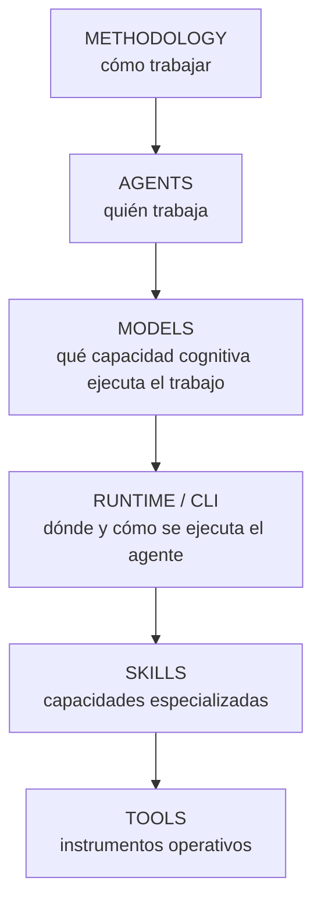

- Separar las capas evita que un proveedor, modelo o herramienta se convierta en el centro de la arquitectura.
- **Independencia de proveedor:** la metodología no pertenece a ningún proveedor de modelos, runtime ni herramienta de especificación; todos son reemplazables.
- **Nombres:** cada capa se nombra por su función, no por la herramienta actual. Si esta cambia, solo cambia la elección anotada en el proyecto (el manifiesto de `spec-first-protocol`), no la metodología.
- **Ampliación:** si más adelante se añade un orquestador, se coloca como una capa entre `METHODOLOGY` y `AGENTS`, sin rediseñar el resto.

---

## 3. Arquitectura general

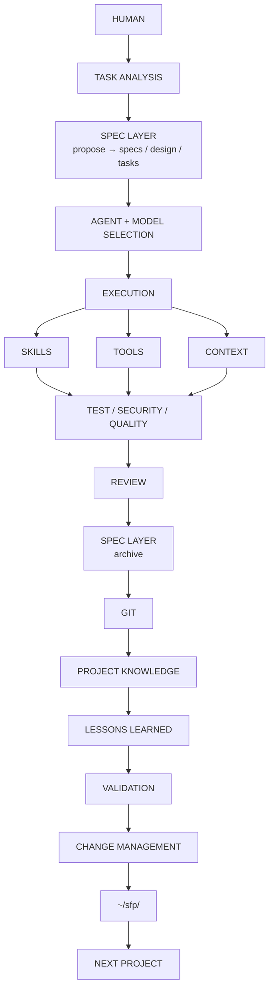

- Ciclo completo: desde la intervención humana hasta generalizar el conocimiento en la metodología global, que alimenta al siguiente proyecto.
- En cambios no triviales (sección 6), la capa de specs (especificaciones por cambio) actúa dos veces: antes de ejecutar (produce el plan que sigue cada sesión) y al cerrar (archiva el cambio y actualiza las specs vigentes del proyecto). El diagrama muestra ese camino. Un cambio trivial (sección 6) salta el nodo SPEC LAYER: va de TASK ANALYSIS directo a AGENT + MODEL SELECTION, con verificación básica en vez de los quality gates (controles de calidad) completos de la sección 11. No es una ruta al margen de la metodología: es la misma, aplicada con menos profundidad porque el riesgo lo permite.
- El nodo VALIDATION es la validación humana de una lección candidata a generalizarse (sección 17.3), no los evals (evaluaciones automáticas) de la sección 22: una infraestructura futura que aún no forma parte de este flujo y que más adelante podría alimentar esta validación con datos, no solo con juicio humano.

---

## 4. Responsabilidades por componente

| Componente | Responsabilidad |
|---|---|
| Human | Decisiones estratégicas y autoridad final |
| Capa de specs | Especificar y planificar cada funcionalidad o cambio |
| Agent | Rol y responsabilidad |
| Model | Capacidad de razonar y ejecutar |
| Runtime / CLI | Entorno de ejecución (CLI: programa de terminal) |
| Skill | Capacidad especializada (instrucciones que se cargan al necesitarlas) |
| Tool | Instrumento de trabajo |
| Methodology | Estándares de trabajo |
| Git | Estado real del software |
| ADR | Decisiones de arquitectura permanentes |
| Docs | Conocimiento del proyecto |
| Runbooks | Procedimientos operativos |
| Metrics | Medición del sistema |
| Lessons Learned | Experiencias aún no generalizadas |
| `~/sfp/` | Metodología global reutilizable |

- Ninguna capa debe asumir responsabilidades de otra.

---

## 5. Modelo de autoridad

No hay una única jerarquía de autoridad; depende del tema:

| Tema | Autoridad |
|---|---|
| Alcance, objetivos, decisiones estratégicas o críticas, acciones irreversibles, cambios importantes de metodología | **Human** |
| Estado real del software | **Git / archivos** |
| Decisiones y reglas del proyecto | **ADRs y docs del proyecto** |
| Metodología global | **`~/sfp/`** |
| Cómo se ejecuta técnicamente un agente | **Configuración del runtime y del agente** |


- Un proyecto puede apartarse a propósito de una regla global por defecto si su contexto lo exige.
- Una desviación de arquitectura relevante debe documentarse en un ADR (registro de decisión de arquitectura, sección 16).
- Las restricciones críticas de seguridad siguen vigentes salvo decisión humana explícita y controlada.
- Ninguna capa reparte el trabajo: agente y modelo se eligen con los criterios de la sección 9.

---

## 6. Especificación y planificación — capa de specs

- Los cambios **no triviales** se convierten en documentos planificados y versionados (con historial) antes de que un agente escriba código. No viven solo en el chat (sección 15).
- Un cambio es no trivial si toca varios archivos o módulos, cambia comportamiento o contratos (acuerdos entre partes, como una API), o tiene riesgo medio o alto.
- Los cambios triviales (por ejemplo, corregir un error puntual o un texto) pueden ir directo, con verificación básica (sección 11).
- Sin orquestador, estos documentos son además el **estado compartido** entre sesiones: `tasks.md` dice qué está hecho y qué falta, sin depender de la memoria de ningún chat.

**Implementación:** la elige el usuario (o ninguna). SFP define esta capa por su **función**, no por una herramienta: documentos versionados por cambio (propuesta, requisitos, diseño y tareas) que se archivan al cerrar. Las capacidades y límites de la herramienta elegida se averiguan con el cuestionario de la sección 1 de `tooling.md` (skill `spec-first-protocol`); lo que diga este texto sobre una herramienta concreta no cuenta como fuente.

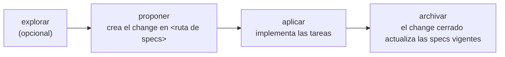

Cada cambio (*change* en el diagrama) produce cuatro documentos versionados en el repositorio del proyecto. Sus nombres los fija la herramienta elegida; entre paréntesis, los habituales:

- Propuesta (`proposal.md`): por qué se hace el cambio y qué cambia.
- Requisitos (`specs/`): con escenarios comprobables (p. ej. `WHEN/THEN`).
- Diseño (`design.md`): enfoque técnico.
- Tareas (`tasks.md`): lista de pasos, unidad de trabajo de cada sesión.

- Requisito para la herramienta: ser **independiente del runtime** (texto plano en el repositorio, usable desde cualquier asistente), como pide la sección 2. Si no lo es, se declara como límite.

### 6.1 Frontera con ADR — evitar duplicación

La spec y el ADR (sección 16) son distintos; respetar la diferencia evita romper el principio de contexto mínimo (sección 13):

| | **Spec (diseño y requisitos del cambio)** | **ADR (sección 16)** |
|---|---|---|
| Responde a | *Qué* se va a construir en esta funcionalidad | *Por qué* se tomó una decisión de arquitectura |
| Vigencia | Vive mientras el cambio está activo; se archiva al terminar | Permanente; no se archiva |
| Alcance | Una funcionalidad o un cambio puntual | Decisión que afecta a varias partes y es difícil de revertir |

- **Regla:** el diseño de un cambio pasa a ADR solo si resulta ser una decisión de arquitectura que afecta a varias partes del sistema, con el mismo criterio y flujo de aprobación que usa la sección 17 para llevar conocimiento a `~/sfp/`.
- Nunca se documenta la misma decisión dos veces en paralelo.

---

## 7. Runtime/CLI vs. Model vs. Agent

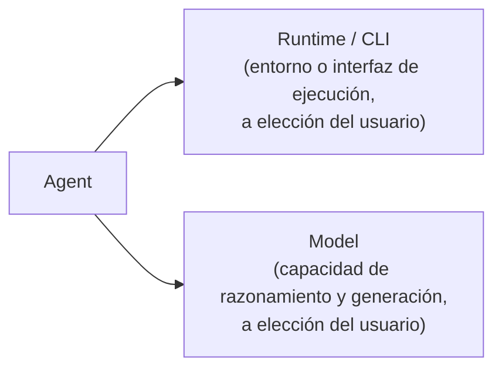

- **Runtime/CLI**: el entorno o la interfaz desde donde se ejecuta un agente.
- **Model**: el que aporta la capacidad de razonar y generar.
- La metodología no debe depender de un runtime concreto.
- Un mismo nombre de familia puede designar un runtime o un modelo según el contexto: el runtime es el programa donde funciona el agente; el modelo, quien razona.
- Sin orquestador, cada sesión de runtime es independiente y usa la capa de specs (sección 6) como fuente de estado compartida.

---

## 8. Agentes

Los agentes representan roles (`Architect`, `Developer`, `Frontend`, `Tester`, `Reviewer`). Cada uno define:

- Responsabilidad, objetivos, entradas y salidas.
- Límites y criterios de calidad.
- Cuándo escalar (pasar el trabajo a un nivel superior).

- Los agentes **no** deben repetir toda la metodología global ni todas las herramientas y skills disponibles.
- Cómo se cargan estas plantillas en una sesión depende del runtime activo (sección 20.2). Aquí se definen como fuente de verdad, no como forma de carga.

Plantillas iniciales:

```
~/sfp/agents/
├── architect.md
├── developer.md
├── frontend.md
├── tester.md
└── reviewer.md
```

---

## 9. Modelos y routing

### 9.1 Tiers de modelo (ejemplo)

- El routing (asignar cada tarea a un modelo) se define por **tiers de capacidad** (niveles), no por modelos concretos.
- Los modelos de la tabla son **ejemplos**: cada usuario asigna a cada tier el que mejor se ajuste a sus necesidades, plan y presupuesto.

| Tier | Uso | Modelo (criterio) | % objetivo (ejemplo) |
|---|---|---|---|
| Alta capacidad | Riesgo o complejidad altos | El modelo más capaz disponible | 50% |
| Generalista | Trabajo normal y bien definido | Un modelo con buen equilibrio capacidad/coste | 30% |
| Ligero | Tareas simples y de bajo riesgo | El modelo más barato o rápido disponible | 20% |

- Los porcentajes son un reparto medio de ejemplo, no cuotas fijas.
- El routing considera: complejidad, riesgo, ambigüedad, impacto, capacidad necesaria, coste, velocidad e historial de rendimiento.
- Los modelos de cada tier y el reparto pueden cambiar cuando la experiencia y las métricas demuestren una configuración mejor.

### 9.2 Rol de cada tier

**Alta capacidad**: interviene donde el riesgo o la complejidad lo justifican, no en todo el trabajo:
- Arquitectura, planificación compleja, decisiones críticas, lógica de negocio difícil.
- Depuración compleja, refactors (reestructurar código) delicados, seguridad, cambios entre sistemas.
- Integraciones complejas, revisión final, pros y contras, ADRs.

**Generalista**: trabajador principal:
- Implementación normal, APIs, CRUD (operaciones básicas de datos), tests, migraciones, scripts.
- Integraciones, documentación, exploración del repositorio, código repetitivo.
- Actualización de dependencias, errores simples o medios, preparación de PRs (peticiones de integración), refactors normales.

**Ligero**: trabajador completo, no limitado artificialmente a tareas triviales:
- Implementación, refactors, depuración, tests, APIs, exploración, documentación, mantenimiento.
- Funcionalidades de complejidad baja/media, tareas en paralelo, alternativas de implementación.
- Su lugar en el sistema depende de su rendimiento real.

### 9.3 Criterios de selección de modelo

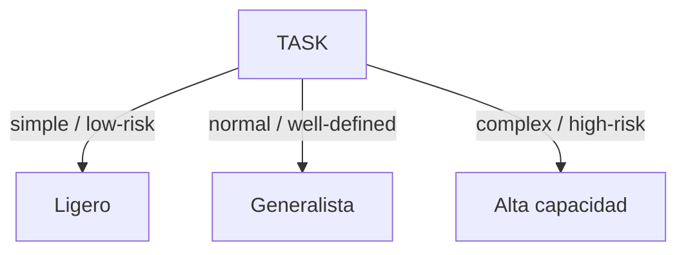

- Las señales de alto riesgo se fijan de antemano, no caso por caso (por ejemplo: toca producción, autenticación, datos o contratos de API). Si se cumple alguna, la tarea va al tier de Alta capacidad.
- Estas señales deciden qué **modelo** usar, no si hace falta **aprobación humana** (eso lo deciden las acciones de alto impacto de la sección 12, aunque algunas coincidan, como "producción"). Una tarea puede requerir Alta capacidad sin aprobación humana, y al revés: ambas listas son fijas y previas, pero responden a preguntas distintas.

### 9.4 Escalamiento progresivo

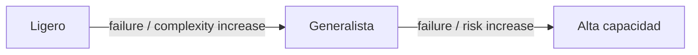

- Escalar debe basarse en evidencia: errores, bloqueos, incertidumbre, riesgo, complejidad o resultados insuficientes.

### 9.5 Revisión crítica

En las tareas críticas, quien implementa no es quien valida:


- Sin orquestador, implementar y revisar son sesiones separadas e independientes: la revisión se hace en **otra sesión**, con otro modelo o runtime (por ejemplo, uno implementa y otro revisa buscando huecos).
- La revisión debe recibir como entrada el cambio de la capa de specs (requisitos y tareas) y el diff (cambios en el código), no el historial del chat de implementación.

### 9.6 Ciclo de vida de una feature importante

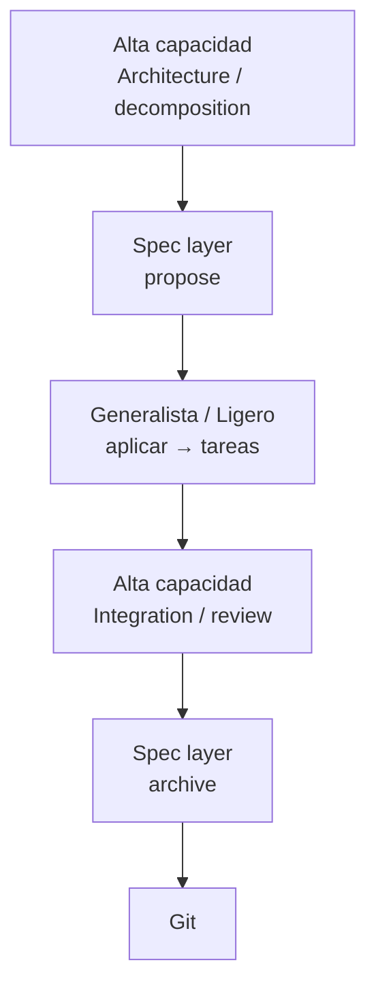

- Cada ítem de `tasks.md` se trabaja en su propia sesión; si varias corren en paralelo, cada una usa su propio git worktree (copia de trabajo) o rama.
- Se usa solo cuando reduce tiempo sin aumentar innecesariamente el riesgo de integración.

---

## 10. Ciclo de vida del desarrollo

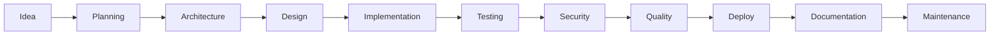

- La profundidad de cada fase depende del riesgo y la complejidad del proyecto.
- El ciclo propuesta → diseño → tareas de la capa de specs (sección 6) ocurre en **Planning/Architecture/Design** (planificación, arquitectura, diseño).
- En **Implementation**, cada sesión ejecuta ítems de `tasks.md` (sección 6) con el agente y modelo elegidos según la sección 9.

---

## 11. Quality gates

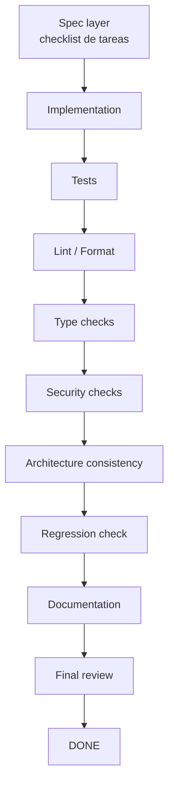

- No todas las tareas pasan todos los controles: la profundidad depende del riesgo.
- **Modificación trivial** → implementación + verificación básica.
- **Modificación crítica** → tests + tipos + lint (revisión automática) + seguridad + arquitectura + regresión (no romper lo que funcionaba) + documentación + revisión.
- El sistema debe evitar burocracia innecesaria.

---

## 12. Seguridad y aprobación humana

- Principio: **mínimo privilegio**: los agentes reciben solo los permisos necesarios.
- Las acciones de alto impacto (producción, operaciones destructivas, secretos (claves), pagos, infraestructura crítica, borrado masivo, cambios globales o de metodología) siguen este flujo. Esta lista no es la de señales de alto riesgo de la sección 9.3: aquella decide qué modelo usar; esta, si hace falta aprobación humana. Ambas son fijas y pueden coincidir en parte, pero no son intercambiables.


- La intervención humana importa sobre todo en decisiones estratégicas, cambios de alcance, acciones irreversibles, seguridad crítica y cambios importantes de arquitectura o metodología.
- **Implementación actual:** cada runtime configura permisos y restricciones con su propio mecanismo (archivo o panel de configuración), generado o enlazado desde la carpeta global según la sección 20.2; la persona aprueba las acciones de alto impacto en la propia sesión.
- Sin una capa central que haga cumplir los permisos, cada runtime debe configurarse con lo mínimo necesario antes de usarse.

---

## 13. Gestión del contexto

- El contexto (lo que el agente tiene cargado) es un recurso limitado. Principio rector:

> **No cargar contexto que el agente no necesita.**

Se aplica mediante:

- Contexto mínimo suficiente.
- Revelación progresiva (progressive disclosure): primero lo esencial.
- Recuperación justo a tiempo.
- Documentación persistente.
- Skills especializados.
- Memoria estructurada.

- La información se busca al necesitarla, no por adelantado.

---

## 14. Jerarquía de contexto

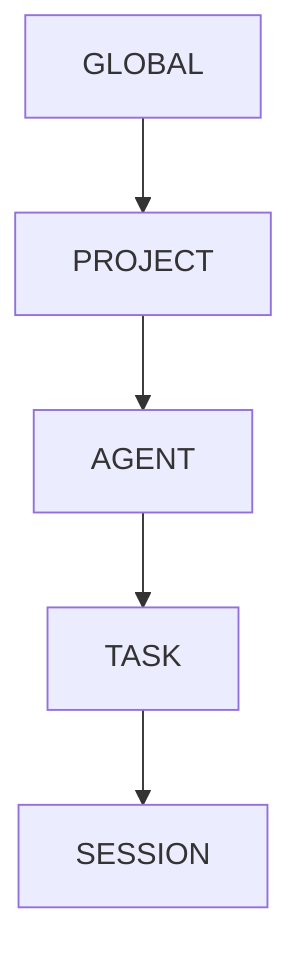

- Cada nivel aporta solo la información relevante para su alcance.

---

## 15. Memoria: chat, proyecto y metodología global

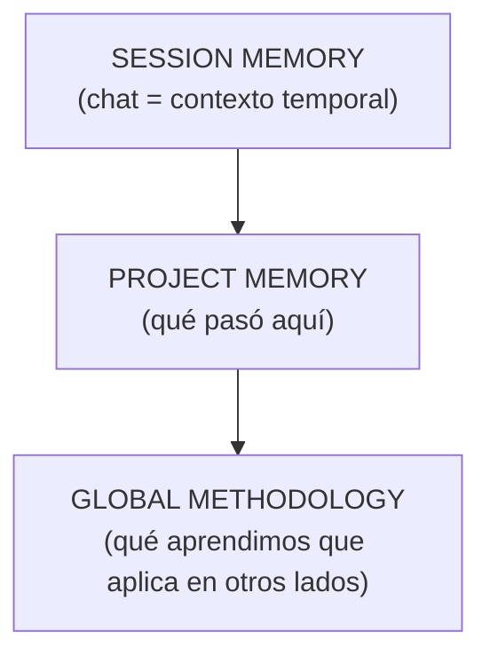

- El chat es contexto de trabajo temporal, **no** la fuente permanente de conocimiento. Ese conocimiento vive en registros:

| Registro | Contiene |
|---|---|
| Git | Estado real del software |
| ADR | Decisiones de arquitectura |
| Docs | Conocimiento del proyecto |
| Runbooks | Procedimientos operativos |
| `~/sfp/` | Metodología global |

- Separar la memoria del proyecto de la global reduce ruido, contexto innecesario, mezcla entre proyectos, reglas falsas y sobrecarga mental.

---

## 16. Git y ADRs

- **Git** (control de versiones) es la fuente de verdad del estado real del software: código, configuración, historial, ramas, commits, documentación versionada y cambios. La conversación no lo sustituye.
- **Los ADRs (Architecture Decision Records)** registran decisiones de arquitectura importantes: difíciles de revertir, que afectan a varias partes o con pros y contras relevantes. No las triviales.

```
docs/
└── adr/
    ├── 0001-use-postgresql.md
    ├── 0002-authentication-strategy.md
    └── 0003-event-architecture.md
```

- Cada ADR debe incluir: **Status, Context, Decision, Alternatives, Consequences, References**, para conservar el razonamiento y no solo el resultado.
- **Runbooks**: procedimientos operativos repetibles (despliegue, rollback, recuperación, migraciones, resolución de problemas, respuesta a incidentes, mantenimiento). El razonamiento de arquitectura va en el ADR.

---

## 17. Conocimiento de proyecto vs. metodología global

- El conocimiento propio de un proyecto (arquitectura, decisiones, APIs, integraciones, convenciones, infraestructura, resolución de problemas) pertenece a ese proyecto. No se traslada automáticamente a otros.

### 17.1 De la experiencia a la lección aprendida

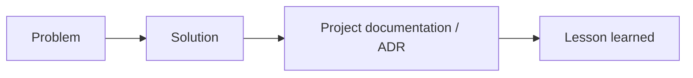

### 17.2 Promoción de conocimiento a metodología global

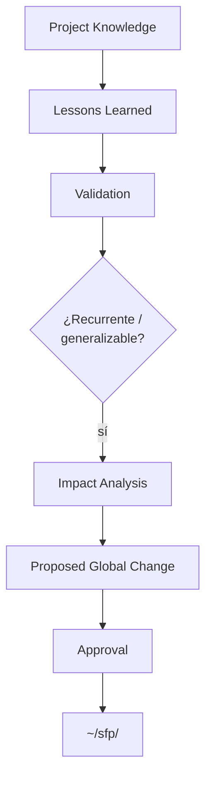

- Regla central: los proyectos generan conocimiento; `~/sfp/` guarda solo el conocimiento generalizable y validado (ver sección 24).
- Un agente **no** debe cambiar por su cuenta la metodología global solo porque haya aprendido algo: siempre debe pasar por el flujo anterior.

### 17.3 Criterios para promover una experiencia a global

Una experiencia se promueve a global cuando:

- Aparece repetidamente.
- Resuelve un problema general.
- Demuestra valor.
- Sirve para varios proyectos.
- Tiene un coste de adopción razonable.
- No añade complejidad desproporcionada.
- Ha sido validada.

### 17.4 Implementación actual: registro manual de lecciones

Sin orquestador no hay registro automático de resultados: el flujo de las secciones 17.1 a 17.2 se hace a mano.

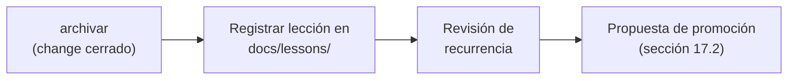

- Al archivar un cambio relevante, se anota una lección corta en `docs/lessons/` del proyecto, con el formato **"Aplica cuando: …"**, para encontrarla justo cuando haga falta.
- Solo se anota lo no obvio: dificultades reales, errores repetidos, decisiones que costaron tiempo.
- Para llevar una lección a `~/sfp/` se siguen los criterios de la sección 17.3; como guía, conviene esperar a que la lección aparezca de forma independiente al menos tres veces.
- La aprobación (sección 12) siempre la da una persona.

---

## 18. Gestión de cambios en la metodología

- Los cambios en `~/sfp/` siguen un proceso formal, para que no se convierta en una colección de reglas accidentales.
- Este proceso **continúa el flujo de la sección 17.2** (Project Knowledge → ... → Approval → `~/sfp/`). El paso adicional es el versionado formal del cambio:

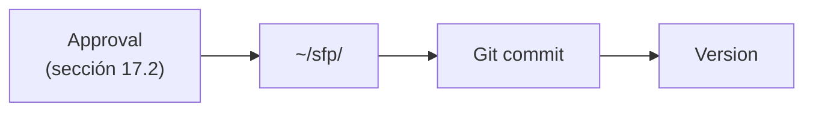

- `~/sfp/` debe estar versionado con Git, para rastrear qué cambió, por qué, cuándo, qué experiencia lo originó y qué impacto tuvo.

---

## 19. Principios anti-crecimiento descontrolado

- **Anti-generalización**: no convertir una experiencia aislada en una regla global; añadir solo lo que demuestre valor.
- **Anti-sobreingeniería**: el sistema no debe exigir más mantenimiento que los proyectos que ayuda a construir. Cada archivo, skill, agente, herramienta, proceso o regla debe justificar su existencia.

> No añadir complejidad porque podemos; añadirla porque la experiencia demuestra que hace falta.

- `~/sfp/` es una **metodología viva**, no documentación terminada.
- Empieza con plantillas, principios, estructuras base y reglas iniciales, y evoluciona así:

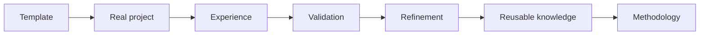

---

## 20. Estructura de la carpeta global

- `~/sfp/` es solo el nombre de ejemplo de la **carpeta de metodología global** en este documento. Su nombre real, ubicación y si coincide o no con el de un proyecto los elige el usuario; la metodología no depende de ese nombre.

```
<carpeta de metodología global>/   (ejemplo: ~/sfp/)
│
├── SYSTEM.md
│
├── methodology/
│   ├── DEVELOPMENT.md
│   ├── ARCHITECTURE.md
│   ├── TESTING.md
│   ├── SECURITY.md
│   ├── DEVOPS.md
│   ├── QUALITY.md
│   └── DOCUMENTATION.md
│
├── skills/
│   └── <skill>/              # uno por capacidad validada (ver Skills)
│
├── tools/
│   └── <tool>/
│
└── agents/
    ├── architect.md
    ├── developer.md
    ├── frontend.md
    ├── tester.md
    └── reviewer.md
```

- La estructura puede cambiar según las necesidades reales; no debe convertirse antes de tiempo en una clasificación excesiva.
- La carpeta de specs (sección 6) va **dentro del repositorio de cada proyecto**, no en la carpeta global: es planificación del proyecto, no metodología global (mismo principio proyecto/global de la sección 17).

### 20.1 Contenido de cada documento de metodología

| Archivo | Cubre |
|---|---|
| `SYSTEM.md` | Propósito, principios, arquitectura, responsabilidades, relación entre capas y reglas fundamentales. **No** contiene todas las reglas operativas. |
| `DEVELOPMENT.md` | Git, ramas, commits, modularidad, dependencias, nombres, convenciones, PRs, colaboración, mantenimiento |
| `ARCHITECTURE.md` | Principios de arquitectura, componentes, límites, acoplamiento y cohesión, interfaces, patrones, decisiones, pros y contras. No impone la misma arquitectura a todos los proyectos |
| `TESTING.md` | Pruebas unitarias, de integración, E2E y de contrato, mocks, fixtures, regresión, cobertura, casos límite (la estrategia depende del proyecto) |
| `SECURITY.md` | Secretos, autenticación y autorización, validación, saneamiento, OWASP, dependencias, registros, mínimo privilegio, seguridad de APIs, errores seguros |
| `DEVOPS.md` | Docker, CI/CD (integración y entrega continuas), entornos, despliegue, migraciones, rollback, secretos, observabilidad, copias de seguridad, recuperación ante desastres |
| `QUALITY.md` | Corrección, mantenibilidad, legibilidad, seguridad de tipos, lint, formato, complejidad, manejo de errores, rendimiento básico, Definition of Done (criterio de "terminado") |
| `DOCUMENTATION.md` | README, docs de APIs, ADRs, runbooks, changelog, documentación técnica y de despliegue |

- Al principio no hay `PERFORMANCE.md` ni `FOLDER_STRUCTURE.md` separados, salvo que la experiencia demuestre lo contrario: el rendimiento va en Quality, y la estructura de carpetas depende de lenguaje, framework, arquitectura, tamaño e infraestructura.

### 20.2 Ubicaciones y carga

- Ningún runtime lee por sí solo la carpeta global: cada IDE, terminal o agente usa su propia ubicación y formato para la configuración del proyecto, agentes y skills, y esa ubicación varía según cuál esté activo.
- Por eso `methodology/`, `skills/`, `tools/` y `agents/` no son, por sí solos, directorios "cargables": son la **fuente de verdad**, independiente del runtime. Para que un runtime los use hace falta una capa de enlace (enlace simbólico, copia generada o archivo de configuración propio) que lleve ese contenido a la ubicación que ese runtime espera.
- Esa capa de enlace es propia de cada runtime, se genera o regenera según cuál esté activo (incluida cada sesión independiente de la sección 7) y no forma parte de la metodología global: es solo la conexión entre la carpeta global y el runtime que use el usuario.
- Las plantillas `agents/*.md` tampoco se cargan solas en una sesión: se usan cuando el runtime activo las referencia o las copia a su propio mecanismo de agentes (subagentes, instrucciones de sistema, perfil de agente, etc.), que depende de cada runtime.
- Qué runtimes admiten este enlace y cómo se hace en cada uno es un detalle de implementación (sección 2), no una regla de la metodología: debe poder generarse para cualquier runtime sin rediseñar la estructura global.

```
<proyecto>/
├── <ruta de specs>/      # la que fije la herramienta elegida
│   ├── <specs vigentes>/
│   └── <changes>/
│       ├── <en-curso>/
│       └── <archivados>/
└── docs/
    ├── adr/               # decisiones permanentes (sección 16)
    ├── runbooks/          # procedimientos operativos (sección 16)
    └── lessons/           # lecciones aprendidas del proyecto (sección 17.4)
```

---

## 21. Skills

- Un skill es una **capacidad especializada**, distinta de una tool (herramienta), un instrumento de trabajo.
- Un skill puede usar varias tools, y una tool puede servir a varios skills.
- Los skills deben aplicar revelación progresiva:

```
skill/
├── SKILL.md
├── references/
├── examples/
└── scripts/
```

- `SKILL.md` es el punto de entrada y dirige al agente a información adicional solo cuando la necesita.
- Esta estructura vive en la carpeta global como fuente de verdad; cómo llega al runtime activo en cada sesión lo resuelve la capa de enlace de la sección 20.2.

Los skills se describen por **función**, no por producto. Cuáles usar (o ninguno) lo decide el usuario; este texto no recomienda ninguno. Las capacidades y límites del skill o la tool elegidos se averiguan con la sección 2 de `tooling.md` (skill `spec-first-protocol`).

| Función | Qué cubre | Cuándo se justifica |
|---|---|---|
| Flujo de trabajo | Planificación, lluvia de ideas, TDD (desarrollo guiado por pruebas), depuración, revisión, verificación, subagentes | Complementa la metodología, no la sustituye |
| Navegación semántica de código | Comprender, editar y reestructurar código por símbolos; analizar el contexto con eficiencia | Repositorios grandes |
| Reducción de ruido de terminal | Menos tokens (texto que procesa el modelo) por salida de comandos, más señal | Optimización operativa, no metodología |
| Visualización de arquitectura | Diagramas de componentes y dependencias | Complementa `ARCHITECTURE.md`, no lo sustituye |
| Diseño visual de frontend | Dirección visual, composición, accesibilidad, animación, coherencia | Solo con frontend (interfaz); no cargar en tareas backend |

### 21.1 Project Setup Skill

Skill de arranque para adoptar la metodología en proyectos nuevos o existentes (implementado como el skill `spec-first-protocol`, que contiene esta metodología completa):


- No debe convertirse en una copia completa de `~/sfp/`.
- Su función es conectar la metodología global con el contexto propio del nuevo proyecto.
- Está implementado por el skill `spec-first-protocol`.

---

## 22. Observabilidad y métricas

- No basta con saber si el software funciona: también hay que saber si el **sistema de agentes** funciona bien.

Métricas iniciales:

- Tasas de éxito, fallo y retrabajo de tareas.
- Latencia y consumo de tokens o peticiones.
- Coste.
- Tasa de escalamiento.
- Correcciones durante la revisión.
- Tiempo hasta resolver.
- Rendimiento por modelo y por tipo de tarea.

- Sin orquestador no hay recogida automática: las métricas se anotan a mano por tarea (modelo usado, escalamientos, correcciones en revisión) en la documentación del proyecto.
- No hace falta montar ya una infraestructura compleja: primero se reúnen datos reales de los proyectos. En el futuro:

```
~/sfp/evals/
├── routing/
├── coding/
├── debugging/
├── testing/
└── architecture/
```

- Los modelos se evalúan por tipo de tarea (programación, depuración, arquitectura, pruebas, revisión), y el reparto puede cambiar según los resultados.

---

## 23. Principios fundamentales

1. Independiente de agente.
2. Independiente de modelo.
3. Independiente de runtime.
4. Independiente de herramienta de especificación.
5. Consciente del proyecto.
6. Git como fuente de verdad del software.
7. ADRs como memoria de decisiones de arquitectura; la capa de specs como memoria de ejecución de una funcionalidad (sección 6.1): nunca ambos para lo mismo.
8. Docs como conocimiento del proyecto.
9. Chat como contexto temporal.
10. Revelación progresiva.
11. Contexto mínimo necesario.
12. Mínimo privilegio.
13. Control humano sobre las decisiones críticas.
14. Evolución basada en evidencia.
15. No globalizar experiencias aisladas.
16. Añadir complejidad solo cuando esté justificada.
17. Medir el sistema.
18. Separar ejecución de validación.
19. Usar capacidades especializadas solo cuando sean relevantes.
20. Mantener ligera la metodología global.
21. Preferir conocimiento reutilizable validado a instrucciones duplicadas.
22. Preferir herramientas maduras que ya resuelven un problema a crear metodología adicional para lo mismo (sección 6).

---

## 24. Definición final del sistema

> **Spec-First Protocol (SFP)** es un sistema personal, independiente de proveedores, para desarrollar software con varios agentes y modelos que trabajan en sesiones independientes. Se planifica con especificaciones versionadas cuando el cambio lo merece y usa una metodología global versionada, conocimiento propio de cada proyecto, memoria técnica persistente, documentación, ADRs, skills especializados, herramientas, quality gates, seguridad, observabilidad y aprendizaje continuo basado en experiencia real.

Glosario de capas (arquitectura general: sección 3):

| Capa | Significado | Implementación |
|---|---|---|
| Spec Layer | Planificación y especificación por funcionalidad | A elección del usuario (o ninguna); capacidades y límites con la sección 1 de `tooling.md`; ver sección 6 |
| Methodology | Cómo funciona el sistema | `~/sfp/` |
| Agents | Quién trabaja | — |
| Models | Capacidad de razonar y ejecutar | La elige el usuario; criterios en la sección 9.1 |
| Runtimes | Entorno de ejecución | La elige el usuario |
| Skills | Capacidades especializadas | Las elige el usuario; funciones en la sección 21; verificación con la sección 2 de `tooling.md` |
| Tools | Instrumentos de trabajo | — |
| Git | Estado del software | — |
| ADRs | Decisiones de arquitectura (permanentes) | `docs/adr/` |
| Project Docs | Conocimiento del proyecto | — |
| Runbooks | Procedimientos operativos | `docs/runbooks/` |
| Metrics | Medición del sistema | Registro manual (sección 22) |
| Lessons Learned | Experiencia pendiente de validar | `docs/lessons/` (sección 17.4) |
| `~/sfp/` | Metodología global validada | — |
| Project-Setup Skill | Puesta en marcha de la metodología en proyectos | Skill `spec-first-protocol` |

Reglas centrales del sistema: ver secciones 2, 17 y 19.
